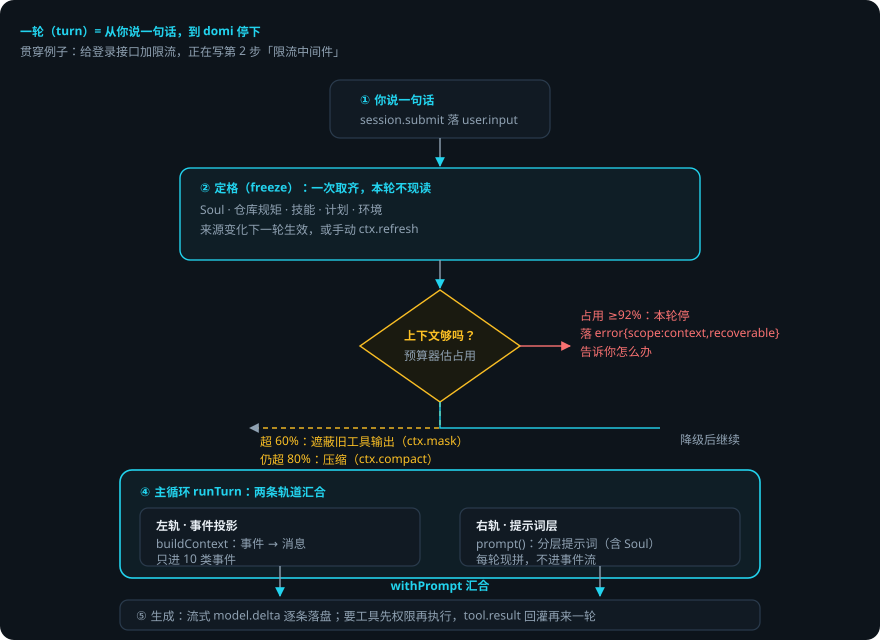
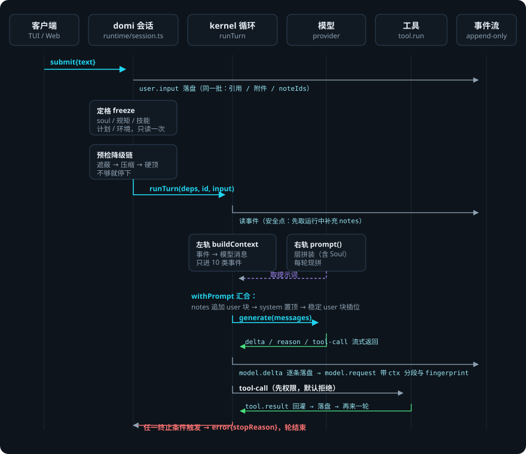
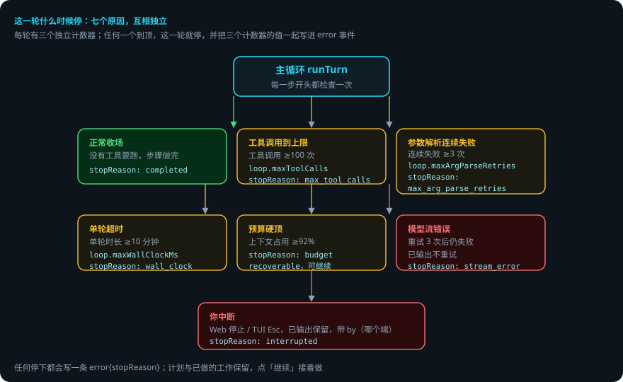

# Agent Loop：一轮里发生了什么

> 本页回答四个问题：domi 怎么把你说的一句话变成一连串动作？一轮什么时候停？上下文快满了怎么办？出错了会怎样？
> 贯穿例子：目标「给登录接口加限流」，计划第 2 步「写限流中间件」正在进行。

## 先说结论

- domi 把你说的一句话当作**一轮**。一轮从 `session.submit` 开始，到写一条 `error` 事件收场。
- 一轮开始时，domi 先**定格**一份快照：Soul、仓库规矩、技能清单、计划、环境变量。本轮内不再现读。
- 发请求前，domi 按**预算器**预检：上下文快满时先遮蔽旧工具输出，再压缩，还不够就停下。
- 模型看到的内容由**两条轨道**拼成：事件投影（历史说了什么）+ 提示词层（domi 是谁、有什么规矩），在 `withPrompt` 汇合。
- 一轮有三个独立上限：工具调用 100 次、参数解析连续失败 3 次、单轮 10 分钟。任何一个到顶就停。
- 出错了**不会自动重跑**。已做的工作和计划都保留，你点「继续」才接着做。
- 任何拼装阶段的异常都转成事件落盘，不会把 daemon 拖垮。

## 用到的词

| 词 | 意思 |
|---|---|
| 一轮 | 从你说一句话，到模型这次停下。 |
| 定格 | 一轮开始时，domi 把本轮要用的内容一次取齐。本轮内不再现读。 |
| 事件投影 | 把事件流里的历史拼成模型消息（左轨）。 |
| 提示词层 | domi 的身份、规矩、Soul、计划等分层内容（右轨）。 |
| 预算器 | 估算上下文占用的工具。占用超过阈值就降级。 |
| 遮蔽 | 把旧的工具输出换成指针，事件原文不动。 |
| 压缩 | 把中间一段历史换成摘要。 |
| 终止条件 | 让这一轮停下的原因。 |

## 1. 总体流程

1. 你说一句话。domi 落一条 `user.input`，并把它标记为这一轮的开始。
2. domi 定格：Soul、仓库规矩、技能清单、计划、环境变量一次取齐。
3. domi 预检：按预算器估占用。超过阈值就降级（见第 3 节）。
4. domi 跑主循环：拼上下文 → 生成 → 落盘 → 执行工具 → 回灌，直到满足终止条件。
5. domi 写一条 `error` 事件，说明这轮为什么停。一轮结束。

## 2. 定格：一轮开始时 domi 先记下什么

domi 在一轮开始时取一份快照，包含五样东西：

| 内容 | 说明 |
|---|---|
| Soul | 从记忆里取的人格层（人类可读的 Markdown） |
| 仓库规矩 | 项目里的 AGENTS.md 等指令 |
| 技能清单 | 有哪些 Skill（只列不装） |
| 计划 | 任务会话里的步骤清单（见[编排](orchestration.md)） |
| 环境变量 | 当前项目 / 工作目录等 |

**为什么定格**：一轮可能跑几十步，横跨几分钟。如果每步都现读，Soul 改了一半、计划换了版本，模型看到的内容就不一致。定格保证：**这一轮里，模型看到的始终是同一份世界**。

来源变化不会打扰当前请求。它会在下一轮生效；你也可以手动刷新（`ctx.refresh`）。

## 3. 预检：上下文快满时先降级

发请求前，domi 用预算器估算上下文占用。占用 = 上一次模型请求的输入 + 本次新增的内容 ÷ 有效窗口。

预检按三条档位逐级降：

| 占用 | domi 做什么 | 落什么事件 |
|---|---|---|
| ≥60%（节省档 45%） | 遮蔽一批旧工具输出（至少 8000 token） | `ctx.mask` |
| ≥80%（节省档 70%） | 压缩中间历史成摘要 | `ctx.compact` |
| ≥92% | 本轮停，告诉你怎么办 | `error{scope:'context'}` |

每降一级，domi 重新估一次占用。遮蔽腾不出空间，就继续往下走。降到 92% 硬顶，本轮停下——此时 `error` 事件带 `recoverable`，你可以按提示继续。

> 遮蔽和压缩只改变模型**看到**的内容，不改事件流里的原文。详见[压缩与 prompt cache](context-compression.md)。

## 4. 主循环：两条轨道汇合

主循环 `runTurn` 反复执行四件事，直到终止：

**（1）拼上下文（两条轨道）**

| 轨道 | 干什么 | 内容 |
|---|---|---|
| 左轨 · 事件投影 | `buildContext` 把历史事件拼成模型消息 | 只进 10 类：user.input、user.note、ctx.note、ctx.ref、ctx.fileref、model.reason（可选）、model.delta、tool.call、tool.result、verify.required。其余事件（权限、用量、遮蔽、压缩等）是轨迹，不进上下文 |
| 右轨 · 提示词层 | `prompt()` 现拼分层提示词 | 身份 → 规矩 → 能力 → 约定 → Soul（非空才放）→ 技能清单 → 用户自定义 → 工作区 → 计划。每轮现拼，不进事件流 |

两条轨道在 `withPrompt` 汇合：运行中的补充（notes）追加成新的用户消息 → 系统块放最前 → 稳定用户块插在第二位。这样动态内容永远**追加**，不改已发出的消息，前缀保持稳定。

**（2）生成**。domi 把拼好的消息交给模型。模型流式返回，domi 把每一条增量逐条落盘。`model.request` 事件同时记录上下文分段（右侧栏用）和前缀指纹（用来发现缓存前缀断裂）。

**（3）执行工具**。模型要求调用工具时，domi 先过权限（默认拒绝，每个决定都落一条事件），再执行。工具不能自己写事件流——它把事件交出来，由主循环统一落盘。工具结果回灌上下文，循环继续。

**（4）检查终止条件**。每步开头都检查一次（见下一节）。

**运行中补充**：模型跑着的时候你也能打字。补充先排队，在主循环的安全点送达（此时上一步的工具结果都已落盘，不会插进 tool_use 和 tool_result 之间）。收场前还会再取一次，取到就追加并继续。

**动态变化**：计划更新、环境变化这类内容，当轮通过追加消息送达，同时落一条 `ctx.note` 事件。下一轮照样可见。

## 5. 这一轮什么时候停

三个独立计数器，任何一个到顶就停：

| 上限 | 默认 | 配置项 |
|---|---|---|
| 工具调用次数 | 100 次 | `loop.maxToolCalls` |
| 参数解析连续失败 | 3 次 | `loop.maxArgParseRetries` |
| 单轮时长 | 10 分钟 | `loop.maxWallClockMs` |

加上另外四种停法：

- **正常收场**：没有工具要跑，步骤都做完了。
- **预算硬顶**：上下文占用 ≥92%。
- **模型流错误**：模型接口持续报错，自动重试 3 次（间隔递增、带随机抖动）后仍失败。模型已经输出后断掉不重试，避免你看到重复的半句话。
- **你中断**：Web 点「停止」、TUI 按 `Esc`。已输出的内容保留。

任何停下都会写一条 `error{stopReason}` 事件，带上三个计数器的值。停下后：计划保留、已做的工作保留、界面显示「上次被打断了」和「继续」按钮。

## 6. 出错了怎么办：第 2 步写到一半，类型检查报错

还是「给登录接口加限流」。这一轮里，模型正在写第 2 步「写限流中间件」。它改了 `app.ts`，跑 `bun test`，类型检查报错。

1. **报错是工具结果，不是轮结束**。domi 把报错交回模型，这一轮不会因为一次报错就停。
2. **模型自己处理**。它读报错，选一种做法：修好再试（最常见）、换个办法、或者问你。
3. **修好就继续**。重跑测试通过，工具结果回灌，循环继续。
4. **修不好，上限兜底**。工具调用次数、解析重试、或墙钟到顶，这一轮停。`error` 事件写明原因。
5. **停后不自动重跑**。`app.ts` 改了一半——要不要再来一次，由你决定。你点「继续」，模型先查当前状态，再从断点接着做。

**如果模型接口一直报错**：domi 自动重试 3 次（间隔逐次加倍、带抖动），仍失败就收场，会话不丢。你换个模型，再点「继续」。

**如果你点停止**：已输出的内容保留，工具中止，`error{stopReason:'interrupted'}` 落盘。

### 一张表看全部情况

| 情况 | domi 做什么 | 你要做什么 |
|---|---|---|
| 工具报错 | 把结果交回模型，模型修复、换办法或问你 | 通常不用管 |
| 模型接口持续报错 | 重试 3 次（间隔递增带抖动），仍失败停这一轮 | 换个模型，再点「继续」 |
| 工具调用到 100 次 | 停这一轮，计数器写进 error | 点「继续」，或改做法 |
| 参数解析连续失败 3 次 | 停这一轮 | 点「继续」，或检查工具调用 |
| 单轮超 10 分钟 | 停这一轮 | 点「继续」，或拆小任务 |
| 上下文占用 ≥92% | 停这一轮，error 带可恢复标记 | 按提示压缩，或点「继续」 |
| 你点「停止」 | 停这一轮，已输出保留 | 点「继续」，或说新要求 |
| 拼装阶段异常 | 转成 error 事件落盘，不穿出 | 下一次提交照常能跑 |

## 7. 可靠性靠什么

1. **记录在先，进度是算出来的。** 每一步（输入、输出、工具调用、结果、停止原因）都是一条事件。跑到哪一步，从事件算出来，没有另外的状态文件。任何时刻被杀，重启后重读记录就知道停在哪。
2. **事件只追加，不修改。** 遮蔽、压缩都只追加事件，不改历史。回放和审计看到的永远是真的。
3. **决策与效果分离。** 主循环的输出是事件，事件是纯数据，纯数据可断言。大部分逻辑不用起 daemon 就能测。
4. **三个上限独立计数。** 停下时记下所有计数器的值。事后能看出是哪个上限、谁中断的。
5. **异常不外溢。** 拼装阶段的任何异常都转成事件落盘，不会让整个 daemon 崩掉。
6. **工具不自己写库。** 工具把事件交出来，由主循环统一落盘。顺序和事务边界只有一个地方管。

## 已知限制

- 单轮最长 10 分钟（可配 `loop.maxWallClockMs`），超长任务请用[长任务](orchestration.md)。
- 模型开始输出后断流不重试——避免重复半句话，但这也意味着那次输出丢失。
- 定格的内容本轮内不刷新：改了配置要等下一轮或手动刷新（`ctx.refresh`）才生效。
- 主循环是串行的：同一会话同一时间只跑一轮，第二个提交会收到「忙」。

## 代码在哪里

| 主题 | 位置 |
|---|---|
| 主循环 runTurn、终止条件、安全点 | `packages/kernel/src/loop.ts` |
| 事件投影（左轨） | `packages/kernel/src/build-context.ts` |
| 两轨汇合 withPrompt | `packages/kernel/src/preamble.ts` |
| 预算器与档位判定 | `packages/kernel/src/budget.ts` |
| 降级链编排（遮蔽→压缩→硬顶） | `packages/runtime/src/degrade.ts` |
| 定格、prompt() 层拼装（含 Soul 注入）、预检触发 | `packages/runtime/src/session.ts` |
| 压缩与遮蔽的实现 | `packages/memory/src/{compact,mask,strategy}.ts` |
| 模型接口重试 | `packages/model/src/retry.ts` |
| 端口接口（kernel 依赖什么） | `packages/kernel/src/ports.ts` |
| 事件契约 | `packages/protocol/src/event.ts` |

测试：`packages/kernel/test/loop.spec.ts`（终止条件、安全点、异常转事件）；L1 回放跑的是真的 `runTurn`（见[评估体系](eval.md)）。

## 相关

- 分层提示词与 Soul 的动态注入：[提示词分层与 cache 边界](prompt-assembly.md)。
- 遮蔽 / 压缩 / 预算器细节：[压缩与 prompt cache](context-compression.md)。
- 一轮之上的计划、审批与长任务：[编排](orchestration.md)。
- 工具与权限引擎：[工具与权限运行时](tools-runtime.md)。
