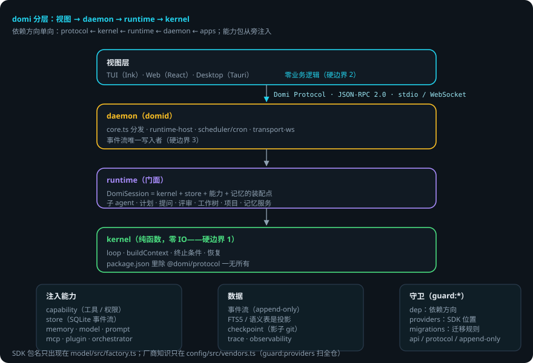
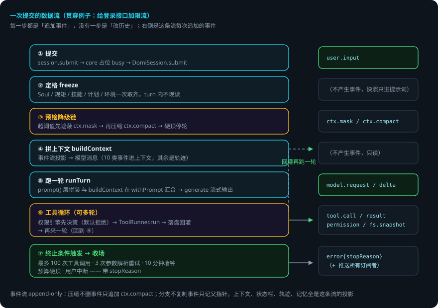

# 架构：domi 内部结构导图

> 本页回答四个问题：domi 由哪些部分组成？一条消息进去后发生什么？为什么 kernel 必须零 IO？出错了会怎样？
> 用它定位自己在代码库里的位置，然后深入各子系统专项文档。
> 贯穿例子：给登录接口加限流——从你点发送，到 domi 改完文件、给你看 diff。

## 先说结论

- domi 分四层：视图层 → daemon → runtime → kernel，外加从旁注入的包。
- **kernel 零 IO**：纯函数，不碰存储、网络、模型。它要什么，都从 ports 注入。
- **daemon 是事件流的唯一写入者**。客户端只提交意图，同一会话串行。
- 一条消息走六步：提交 → 定格 → 预检降级 → 拼上下文 → 跑一轮 → 工具循环，直到终止条件触发。
- 事件流只追加，不改写。上下文、轨迹、记忆全是这条流的**投影**。
- 依赖方向单向：`protocol ← kernel ← runtime ← daemon ← apps`。

## 用到的词

| 词 | 意思 |
|---|---|
| 视图层 | 终端（TUI）、网页（Web）、桌面壳（Desktop）。零业务逻辑。 |
| daemon | 后台进程 domid。会话宿主、事件唯一写入者。 |
| kernel | 纯函数 agent loop：拼上下文、跑一轮、终止条件、恢复。 |
| runtime | 装配点：把 kernel + store + 记忆 + 能力拼成 DomiSession。 |
| 投影 | 从事件流算出来的视图（上下文、轨迹、状态栏）。 |
| 注入 | 把外部能力（事件读写、工具执行、时钟）通过接口递给 kernel。 |

## 1. 总体流程





## 2. 四条边界

三条硬边界由 `guard:dep`（depcruise + 物理依赖守卫）在 CI 里查：

1. **kernel 零 IO**。`packages/kernel` 不 import 视图、不 import 具体存储 / 网络 / 模型 SDK。它的 `package.json` 里除了 `@domi/protocol` 一无所有——物理上装不了就写不出违规代码。它需要的一切（事件读写、工具执行、时钟）从 ports 注入。
2. **三端零业务逻辑**。`apps/*` 只经 `@domi/client-core` + Domi Protocol 与 daemon 通信。投影逻辑（轨迹、问题框状态机、会话 store）一律放 `packages/client-core`。
3. **daemon 是事件流的唯一写入者**。客户端只提交意图；同一会话串行，第二个请求直接回 `SESSION_BUSY`（不排队、不静默丢弃）。
4. **依赖方向单向**：`protocol ← kernel ← runtime ← daemon ← apps`。`capability / store / memory / model / prompt` 从旁注入，`runtime` 是装配点。

SDK 包名只允许出现在 `packages/model/src/factory.ts`；厂商知识只在 `packages/config/src/vendors.ts`（`guard:providers` 扫全仓）。

## 3. 包结构

`packages/` 共 22 个包，按职责分四组：

| 组 | 包 |
|---|---|
| 核心链 | protocol（契约）· kernel（agent loop）· runtime（门面）· daemon（宿主） |
| 注入能力 | capability（工具注册表 / 权限引擎）· store（SQLite 事件流）· memory（压缩 / Soul）· model（模型接口）· prompt（分层拼装） |
| 扩展宿主 | plugin · mcp · orchestrator（DAG）· codeintel · checkpoint（回滚）· trace · observability |
| 工具 | cli · config · client-core · notify · eval · i18n |

`apps/` 三个端：tui（Ink 7，同一二进制经 `DOMI_INTERNAL_ROLE=daemon` 也可当 domid）、web（Vite + React）、desktop（Tauri 套壳）。

## 4. 一次提交的数据流

还是「给登录接口加限流」。你点了发送：

1. 客户端 `session.submit` → daemon `core.ts` 同步占位 busy，交给 `DomiSession.submit`。
2. runtime 定格（freeze：Soul / 仓库规矩 / 技能清单 / 计划 / 环境一次取齐，turn 内不现读）。
3. 预检降级链：预算器超阈值先遮蔽（`ctx.mask`），再超压缩（`ctx.compact`），硬顶停轮。
4. `buildContext` 从事件流投影出模型消息——只有 10 类事件进上下文，其余是轨迹。
5. kernel 跑 `runTurn`：`prompt()` 层拼装（含动态注入的 Soul 层）与 `buildContext` 在 `withPrompt` 汇合 → `provider.generate` 流式出 `model.delta` → 逐条经 `sink.append` 落盘 → daemon 把新事件作为通知推给所有订阅的客户端。
6. 模型请求工具 → `ToolRunner.run` 执行，权限引擎先决策（默认拒绝，决策本身就是一条 `permission` 事件）；`tool.result` 落盘后回灌上下文，再来一轮。
7. 任一终止条件触发，产出带 `stopReason` 的 `error` 事件收场。

**事件流是 append-only 的**：以上每一步都是「追加事件」，没有一步是「改历史」。压缩、分支、状态栏、轨迹、记忆、编排状态全部是这条流的投影。

## 5. 事件流是唯一的真相

会话不是一个消息数组，而是一串只追加的事件：`user.input`、`model.delta`、`tool.call`、`permission`、`tool.result`……投影是纯函数——同样的输入永远得出同样的视图。

```ts run
import assert from 'node:assert/strict'

type Ev =
  | { t: 'user.input'; text: string }
  | { t: 'model.delta'; text: string }
  | { t: 'permission'; decision: string }
  | { t: 'model.usage'; raw: Record<string, number> }

function project(events: Ev[]): Array<{ role: string; content: string }> {
  const out: Array<{ role: string; content: string }> = []
  let text = ''
  const flush = () => {
    if (text) out.push({ role: 'assistant', content: text })
    text = ''
  }
  for (const ev of events) {
    if (ev.t === 'user.input') {
      flush()
      out.push({ role: 'user', content: ev.text })
    } else if (ev.t === 'model.delta') text += ev.text
  }
  flush()
  return out
}

const msgs = project([
  { t: 'user.input', text: '你好' },
  { t: 'model.delta', text: '你' },
  { t: 'model.delta', text: '好' },
  { t: 'permission', decision: 'allow' },
  { t: 'model.usage', raw: { input_tokens: 3 } },
])
assert.deepEqual(msgs, [
  { role: 'user', content: '你好' },
  { role: 'assistant', content: '你好' },
])
```

## 6. 出错了怎么办：限流做到第 2 步，工具崩了

1. **工具执行失败**。`tool.result` 带 error 落盘，回灌上下文。模型看到错误信息，下一轮决定重试、换方案还是问用户。domi 不吞错误。
2. **权限被拒**。权限引擎默认拒绝。`permission` 事件落盘，模型得知被拒，改走不需该权限的路径。
3. **会话忙**（另一个请求正在处理）。`SESSION_BUSY` 回给客户端。不排队、不静默丢弃。
4. **终止条件触发**。最多 100 次工具调用 / 3 次参数解析重试 / 10 分钟墙钟 / 预算硬顶 / 用户中断——任一命中就收场，产出带 `stopReason` 的 `error` 事件。
5. **daemon 崩溃**。事件全在 SQLite 里。重启后按事件流重建投影，一条不丢。

### 一张表看全部情况

| 情况 | domi 做什么 | 你要做什么 |
|---|---|---|
| 工具执行失败 | tool.result 带 error 落盘，模型下一轮处理 | 不用管（或看轨迹里的错误） |
| 权限被拒 | 落 permission 事件，模型改路径 | 想放行：在权限面板允许该操作 |
| 会话忙 | 回 SESSION_BUSY，不排队 | 稍后再试 |
| 终止条件触发 | 带 stopReason 收场 | 看 stopReason 决定继续还是调整 |
| daemon 崩溃 | 事件落盘不丢，重启重建投影 | 重启 domid |

## 7. 可靠性靠什么

1. **事件流只追加**。任何历史事件永远可解析（新增类型升 SCHEMA_VERSION 并补 fixture）。
2. **kernel 零 IO**。核心逻辑可测：喂事件、断言输出，不用起服务。
3. **权限默认拒绝**。每个决定都是一条事件，事后可审计。
4. **Tool 是唯一执行原语，Skill 只是文字**。工具 / MCP / 插件 / 引用的输出是数据，不是指令。
5. **投影是纯函数**。同样的流，永远同样的视图；坏了能重放。
6. **边界有守卫**。依赖方向、厂商知识位置、迁移规则都有 `guard:*` 在 CI 里查。

## 已知限制

- 会话串行：同一会话同时只处理一个请求。
- kernel 的纯函数带来样板：每次 IO 都要走注入，改一个端口要动 kernel + runtime 两层。
- 事件流是唯一真相，但 SQLite 单文件是单点；没有集群 / 多副本。
- 投影重算与事件量线性相关：超长会话的首次投影会变慢（有压缩与遮蔽缓解）。

## 代码在哪里

| 主题 | 位置 |
|---|---|
| 进程宿主 / JSON-RPC 分发 | `packages/daemon/src/core.ts` |
| 会话装配点 / 定格 / 降级链 | `packages/runtime/src/session.ts` |
| agent loop / 终止条件 | `packages/kernel/src/loop.ts` |
| 事件投影 | `packages/kernel/src/build-context.ts` |
| 事件存储 | `packages/store/src/*` |
| 权限引擎 | `packages/capability/src/*` |
| 依赖守卫 | `package.json`（`guard:*`） |

## 相关

- 一轮里到底发生什么：[Agent Loop：一轮里发生了什么](agent-loop.md)。
- 客户端怎么与 daemon 通信：[Domi Protocol：daemon 与客户端之间的契约](protocol.md)。
- 上下文怎么被治理：[压缩与 prompt cache](context-compression.md)。
- 各子系统导航：[文档导航](index.md)。
