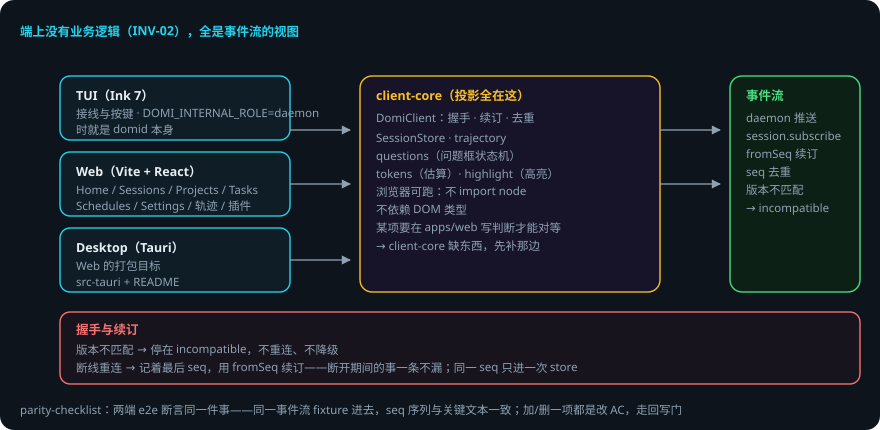

# 三端

> 本页回答四个问题：三端怎么连 daemon？共享层做什么？端上有什么坑？出错了会怎样？
> `apps/tui` · `apps/web` · `apps/desktop` + `packages/client-core`。
> domi 的端规约一句话：**端上没有业务逻辑（INV-02），全是事件流的视图**。
> 贯穿例子：给登录接口加限流——你在 Web 设置页改配置，TUI 里跑任务。

## 先说结论

- 三端连 daemon 都走 `DomiClient` 这一个类：**握手 / 断线重连+断点续订 / 去重**三件事，渲染层一件都不用管。
- 断线重连用 `session.subscribe` 的 `fromSeq` 续订——断开期间的事一条不漏。
- client-core 能在浏览器里跑（不 import node 模块、不依赖 DOM 类型）。
- 端上没有业务逻辑：如果某项需要在 `apps/web` 里写判断才能对等，那是 client-core 缺东西，先补那边。
- Web 产物 JS gzip 132KB / CSS gzip 6.3KB（阈值 gzip 250KB，还有余量）。
- M5 曾有 Telegram 桥接，2026-10-09 整块移除（见 `docs/adr/030-remove-telegram-bridge.md`）。

## 用到的词

| 词 | 意思 |
|---|---|
| DomiClient | 三端共用的协议客户端类。 |
| seq | 事件流里递增的序号。 |
| 续订 | 重连后从 last seq 接着订阅。 |
| 投影 | 把事件流变成视图状态的计算。 |
| 接线处 | 端上把输入接进来、把输出打出去的地方。 |

## 1. 总体流程

## 2. 共享层：client-core

三端连 daemon 都走 `DomiClient`（`client-core/src/client.ts`）这一个类，它负责三件事（渲染层一件都不用管）：

1. **握手**：版本不匹配停在 `incompatible`，不重连、不降级。
2. **断线重连 + 断点续订**：每个会话记着最后收到的 seq，重连后用 `session.subscribe` 的 `fromSeq` 续订，断开期间的事一条不漏。
3. **去重**：同一个 seq 只进一次 store。

它必须能在浏览器里跑（不 import node 模块、不依赖 DOM 类型）。投影逻辑（`SessionStore`、`trajectory.ts`、`questions.ts` 的问题框状态机、`tokens.ts` 的 token 估算、`highlight.ts` 的语法高亮）全在这层——某项如果需要在 `apps/web` 里写判断才能对等，那是 client-core 缺东西，先补那边（parity-checklist 的判定规则）。

## 3. TUI（apps/tui，Ink 7）

- `main.tsx` 负责**接线与按键**，不负责业务：组件只认 client-core 的 store。
- 同一个可执行文件还有第二个角色：`DOMI_INTERNAL_ROLE=daemon` 时就是 domid 本身（单二进制里没有别的文件可以跑）。
- 渲染器：默认全屏（终端备用屏）；`tui.renderer: classic` 或 `DOMI_TUI_RENDERER=classic` 回退。首帧前挂过会写 `~/.domi/state/tui-fallback`，之后自动用 classic。
- **已知坑**：不要在 React 组件里调 Ink 的 `renderToString`（reconciler 是单例，嵌套调用在渲染里返回空串、在 effect 里把 yoga 弄崩）；TUI 拿显示行一律走 `useTranscriptLines`（在 setImmediate 里算）。
- 无 TTY 环境验证有限：切片、滚动状态机、滚轮解析、整屏布局有测试，但备用屏进出、真滚轮、Ctrl+O 往返只能在真终端里看。

## 4. Web（apps/web，Vite + React + Tailwind v4）

- 视图：Home（Composer）/ Sessions / Projects（任务树）/ Tasks / Schedules / Settings（模型、权限、确认模式、用量）/ 轨迹页 / 插件页。
- 设置页写的就是 daemon 启动时读的那份配置；`config.set` 白名单排除权限 / hooks / MCP / 插件安装（界面不能给自己提权，见[配置与厂商](config.md)）。
- 界面文案走 `@domi/i18n`：`apps/*` 里不许出现写死的中文（`guard:i18n`），UI 用 `tr()`。

## 5. Desktop（apps/desktop，Tauri）

Web 的一个打包目标（端顺序：TUI → Web → Desktop 套壳）。`src-tauri` + 一个 README。

## 6. 端之间的一致性

`docs/parity-checklist.md` 是 TUI ↔ Web 功能对等的判据本身：一项算「对等」，要求两端 e2e 都有用例且都绿，断言的是**同一件事**——同一份事件流 fixture 进去，两端渲染出来的 seq 序列与关键文本一致。**加一项 / 删一项都是改 AC，走回写门。** 目前两端 e2e 仍缺（Web 等 Playwright；TUI 有假 stdin 可以直接写）。

## 7. 出错了怎么办：网断了，任务还在跑

1. **断线**。DomiClient 重连，`fromSeq` 续订——断开期间的事件一条不漏，store 去重。
2. **版本不匹配**。握手停在 `incompatible`：不重连、不降级。升级对应端。
3. **TUI 首帧挂掉**。写 `~/.domi/state/tui-fallback`，之后自动用 classic 渲染器。
4. **Web 设置页改敏感键**。白名单拒绝——界面不能给自己提权。改配置文件。
5. **两端行为不一致**。parity-checklist 判据：先在 client-core 补投影，再修端。

### 一张表看全部情况

| 情况 | domi 做什么 | 你要做什么 |
|---|---|---|
| 断线 | 重连 + fromSeq 续订 + 去重 | 不用管 |
| 版本不匹配 | 停在 incompatible | 升级对应端 |
| TUI 首帧挂 | 写 tui-fallback，自动用 classic | 不用管 |
| 设置页改敏感键 | 白名单拒绝 | 改配置文件 |
| 端行为不一致 | parity-checklist 判定 | 先补 client-core |

## 8. 可靠性靠什么

1. **连接逻辑单点**：三端共用 DomiClient，行为一致。
2. **续订不丢事件**：断开期间的事件按 seq 补回来。
3. **去重**：同一个 seq 只进一次 store。
4. **业务在共享层**：端上没有业务逻辑，对等由 client-core 保证。
5. **失败可回退**：TUI 渲染器失败自动降 classic。

## 已知限制

- TUI 无 TTY 环境验证有限：备用屏进出、真滚轮、Ctrl+O 只能在真终端里看。
- 两端 e2e 仍缺（Web 等 Playwright，ADR-013）。
- 版本不匹配不自动升级——要用户动手。
- Telegram 桥接已移除，重做路线见 ADR-030。

## 代码在哪里

| 主题 | 位置 |
|---|---|
| DomiClient（握手 / 续订 / 去重） | `packages/client-core/src/client.ts` |
| 投影（store / 轨迹 / 问题框 / tokens） | `packages/client-core/src/{store,trajectory,questions,tokens,highlight}.ts` |
| TUI 接线 / 渲染 | `apps/tui/src/` |
| Web | `apps/web/src/` |
| Desktop 壳 | `apps/desktop/` |
| 对等判据 | `docs/parity-checklist.md` |

测试：`apps/web/test/*.spec.tsx`、`apps/tui/test/*.spec.tsx`（渲染 / 按键级）、`daemon/test/transport.spec.ts`（真 WebSocket 推送）。

## 相关

- 协议客户端细节：[Domi Protocol](protocol.md)。
- 状态栏六项指标（模型 / token / 花费 / 耗时 / 工具数 / 上下文占用）：`observability/src/report.ts` + client-core 同源格式化。
