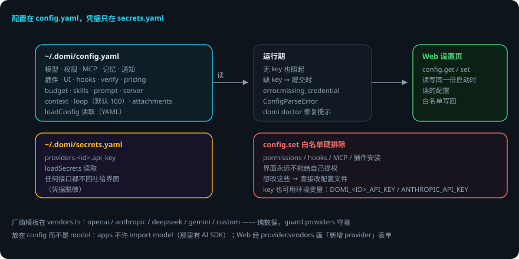

# 配置与厂商

> 本页回答四个问题：配置放哪？厂商知识在哪？什么能通过设置页改？改坏了会怎样？
> `packages/config` —— 配置 schema、加载、secrets、厂商模板。
> 贯穿例子：给登录接口加限流——你在 `config.yaml` 里把 `loop.maxToolCalls` 调大。

## 先说结论

- **配置在 `~/.domi/config.yaml`，凭据只在 `~/.domi/secrets.yaml`**——两份文件，一个原则。
- 「有哪些厂商」这件知识只在 `vendors.ts`（`guard:providers` 守着）：5 家模板，纯数据。
- 缺 key 也照起：模型请求留到提交时报 `error.missing_credential`。
- 凭据任何接口都不回吐给界面。
- **`config.set` 白名单排除 permissions / hooks / MCP / 插件安装**——界面永远不能给自己提权。
- Web 设置页读写的就是启动时读的那一份。

## 用到的词

| 词 | 意思 |
|---|---|
| config.yaml | 主配置（模型 / 权限 / MCP / 记忆 / 上限）。 |
| secrets.yaml | 凭据文件（providers.<id>.api_key）。 |
| 厂商模板 | 纯数据的厂商知识（协议 / 地址 / 能力 / 适配器）。 |
| 白名单 | config.set 允许改的键的名单。 |

## 1. 两份文件，一个原则

- `~/.domi/config.yaml`：模型、权限、MCP、记忆、通知、插件、UI、TUI、hooks、verify、pricing、budget、skills、prompt、server、context、loop、attachments。`loadConfig` 读取（YAML）。
- `~/.domi/secrets.yaml`：凭据（`providers.<id>.api_key`）。`loadSecrets` 读取；任何接口都不回吐给界面（凭据脱敏）。

key 也可以用各家惯用的环境变量（`DOMI_<ID>_API_KEY` + 厂商模板里的惯用名，如 `ANTHROPIC_API_KEY`）。

## 2. 厂商模板（vendors.ts）

**「有哪些厂商」这件知识只在这里**（`guard:providers` 守着）。每个模板是纯数据：`{ id, label, protocol, adapter, defaultBaseUrl?, capabilities, envNames, keyHint }`。

| 厂商 | 适配器 | 说明 |
|---|---|---|
| openai | openai-official | Responses API |
| anthropic | anthropic | 官方 |
| deepseek | openai-compatible | 兼容协议 |
| gemini | 官方 | |
| custom | 自选协议 | 后面挂什么只有用户知道 |

- `PROTOCOLS`：`openai` | `anthropic`；`Adapter`：`openai-official` | `anthropic` | `openai-compatible`。
- 能力矩阵（toolCall / vision / reasoning / promptCache / structuredOutput）是默认值——配置里可显式覆盖。
- 放在 config 而不是 model：apps 不许 import model（那里有 AI SDK），而模板本身不需要 SDK；Web 经 `provider.vendors` 画「新增 provider」表单——两边都不自己写厂商名单。

## 3. 配置 schema 要点（zod）

| 区 | 要点 |
|---|---|
| `model` | 默认模型 = 一个 provider + 一个模型名 |
| `providers` | 每家一段（vendor / protocol / base_url / models / enabled / capabilities 覆盖） |
| `permissions.rules` | 见[工具与权限运行时](tools-runtime.md) |
| `mcp` | servers / allowedHosts / timeoutMs，见[MCP 接入](mcp-internals.md) |
| `memory` / `notify` / `plugins` | enabled / allowUnsandboxed / disabled |
| `ui.locale` | auto \| zh \| en |
| `tui.renderer` | fullscreen \| classic |
| `hooks` / `verify` | 钩子 / 校验 |
| `pricing` | 内置定价表；用量成本只统计有定价表的模型 |
| `budget` | 预算 |
| `skills.enabled` | 技能开关 |
| `prompt` | 自定义提示词层 |
| `server` | port / host / token |
| `context` | 上下文 |
| `loop` | 上限，默认 100 |
| `attachments.maxMB` | 默认 20 |

## 4. 加载与写回

- `load.ts`：`loadConfig`（无 key 也照起；缺 key 留到提交时报 `error.missing_credential`，`data.reason = MISSING_CREDENTIAL`）、`configPath` / `domiHome`、`ConfigParseError`。
- `preflight.ts`：`domi doctor` 的每一条问题带一条能直接粘贴的修复命令。
- `write.ts`：`writeConfigPatch`——Web 设置页读写的就是启动时读的那一份；**`config.set` 的白名单必须排除 permissions / hooks / MCP / 插件安装**——界面永远不能给自己提权。
- `providers.ts`：`providerConnection` / `listProviders` / `credentialEnvNames` / `pricingOf`。

## 5. 出错了怎么办：把 YAML 写坏了

1. **YAML 解析失败**。`loadConfig` 抛 `ConfigParseError`。打开配置看报错行，修 YAML。`domi doctor` 会给修复提示。
2. **缺 API key**。domi 照常启动；模型请求提交时报 `error.missing_credential`（`data.reason = MISSING_CREDENTIAL`）。在 secrets.yaml 或环境变量里补 key。
3. **设置页改了不被允许的键**。白名单拒绝——permissions / hooks / MCP / 插件安装不能经界面改。改配置文件。
4. **厂商能力声明错了**。配置里显式覆盖 capabilities 即可。
5. **不小心删了配置**。domi 用默认值启动；`domi init` 重新生成模板。

### 一张表看全部情况

| 情况 | domi 做什么 | 你要做什么 |
|---|---|---|
| YAML 写坏 | ConfigParseError | 修 YAML / domi doctor |
| 缺 API key | 照起，提交时报 missing_credential | 补 secrets / 环境变量 |
| 设置页改敏感键 | 白名单拒绝 | 改配置文件 |
| 能力声明错 | 按声明拒绝/放行 | 显式覆盖 capabilities |
| 配置被删 | 默认值启动 | domi init 重建模板 |

## 6. 可靠性靠什么

1. **职责分离**：配置与凭据分文件，凭据不回吐。
2. **知识单点**：厂商名单只在 vendors.ts，两边共用不重复写。
3. **缺 key 不崩**：启动不依赖凭据，错误留到真正需要时。
4. **界面不能提权**：config.set 白名单硬排除敏感区。
5. **写回一致**：设置页读写同一份启动时读的配置。

## 已知限制

- YAML 是唯一格式（TOML 支持已删除）。
- 用量成本只统计有定价表的模型（BUILTIN_PRICING 之外不统计）。
- 厂商能力默认值是猜测：custom 的实际能力要靠显式覆盖。
- 白名单保护的是界面路径，直接改文件仍然可能写坏。

## 代码在哪里

| 主题 | 位置 |
|---|---|
| schema（zod） | `packages/config/src/schema.ts` |
| 加载 / 路径 | `packages/config/src/load.ts` |
| 写回 / 白名单 | `packages/config/src/write.ts` |
| 厂商模板 | `packages/config/src/vendors.ts` |
| doctor 问题源 | `packages/config/src/preflight.ts` |
| provider 连接 | `packages/config/src/providers.ts` |

测试：`packages/config/test/`（schema 校验、secrets 加载、vendor 解析、白名单）。

## 相关

- 模型层怎么消费厂商模板：[模型运行时](model-runtime.md)。
- 设置页 RPC：`config.get` / `config.set` / `provider.vendors` 见 [Domi Protocol](protocol.md)。
- 命令行看配置：`domi doctor` / `domi init` 见 [CLI 与命令](cli.md)。
