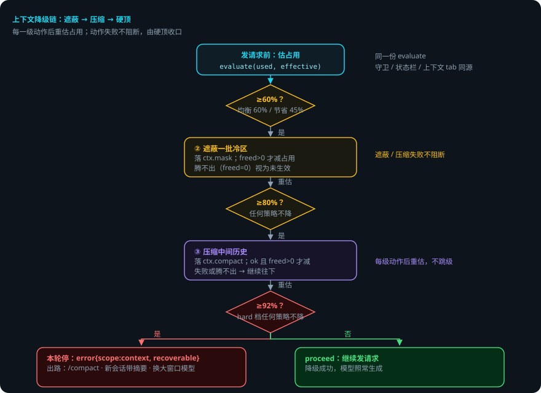
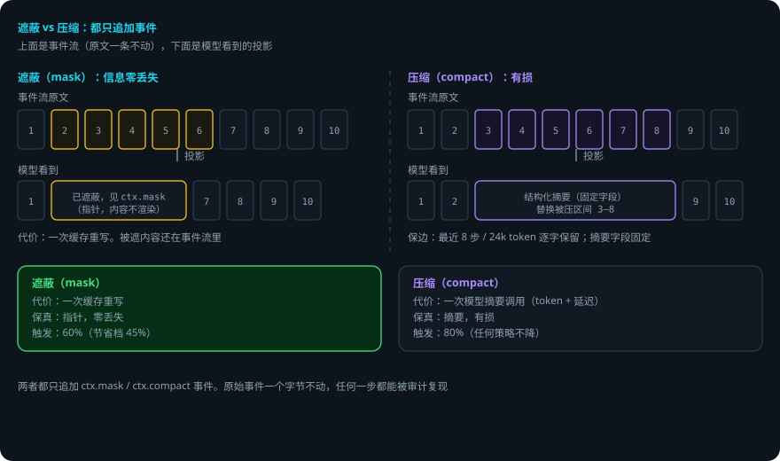

# 上下文压缩与遮蔽：模型看到什么，由你决定

> 本页回答四个问题：上下文快满时 domi 会做什么？遮蔽和压缩有什么区别？硬顶停轮后怎么恢复？哪些内容可以保住不压？
> 贯穿例子：给登录接口加限流。第 2 步「写限流中间件」跑测试，工具输出很大。
> 交互演示：[试一下降级链怎么走](context-compression-explainer.html)

## 先说结论

- domi 用一个**预算器**估算上下文占用。占用分四档：正常、遮蔽、压缩、硬顶。
- 快满时先**遮蔽**：把旧的工具输出换成指针。信息零丢失。
- 遮蔽腾不出再**压缩**：把中间历史换成结构化摘要。信息有损。
- 两种动作都只**追加事件**。原始事件一个字节不动。
- 占用到 92% 硬顶，本轮停下，告诉你三条出路。
- 压缩前先冲刷记忆。压缩后**编辑守卫失效**——模型改文件前必须重读。
- 连续 2 次压缩失败后自动不再触发。手动 `/compact` 永远可用。

## 用到的词

| 词 | 意思 |
|---|---|
| 预算器 | 估算上下文占用的工具。 |
| 档位 | 按占用分出的等级：正常、遮蔽、压缩、硬顶。 |
| 遮蔽 | 把旧工具输出换成指针，模型看不到内容。 |
| 压缩 | 把中间历史换成摘要。 |
| 热区 | 最近 10 步且 32k token 内的工具输出，不遮。 |
| 冷区 | 热区之外的旧工具输出，可遮。 |
| 钉住 | 把某条事件钉住，遮蔽与压缩都跳过它。 |
| 投影 | 模型看到的上下文，由事件流算出来。 |

## 1. 总体流程

1. 发请求前，domi 估占用。
2. 占用到遮蔽档（≥60%，节省档 45%）→ 遮蔽一批冷区。
3. 重估。仍到压缩档（≥80%）→ 压缩中间历史。
4. 重估。仍到硬顶（≥92%）→ 本轮停，落 `error`，告诉你出路。
5. 遮蔽或压缩失败**不阻断**——最终由硬顶收口。

## 2. 预算器：一个数字驱动三档

**有效窗口** = 模型窗口 − 最大输出 − 13k 安全余量（不低于 4096）。

**占用** = 上次真实用量 + 本步增量估算（system + 工具定义 + 新事件）。

`evaluate(used, effective)` 给出档位：

| 占用 | 档位 | domi 做什么 |
|---|---|---|
| ≥60%（节省档 45%） | mask | 遮蔽一批冷区 |
| ≥80% | compact | 压缩中间历史 |
| ≥92% | hard | 本轮停，落 `error{scope:'context', recoverable:true}` |

这一份 `evaluate` 同时供给守卫、状态栏、上下文 tab。三处读同一个数字，不各算各的。

**配置档位**（`context.strategy`）：

- `balanced`：默认。遮蔽阈值 60%。
- `economical`：节省。遮蔽阈值降到 45%。
- 老配置 `full` / `clean` / `compact` 读到时映射为 `balanced`。doctor 会提示，不回写。

> 注意：economical 只调**遮蔽**阈值。压缩档始终是 80%。

## 3. 遮蔽：先把冷区藏起来

遮蔽只动**冷区**的 `tool.result`：

- 热区不遮：最近 10 步（以 `model.request` 为步起点）且 32k token 内的工具输出。
- 钉住的跳过。已遮蔽的 seq 保持不变。
- 单批至少腾出 **8k token** 才落一条 `ctx.mask`。按批记账，不逐条刷屏。

模型看到的是指针「已遮蔽，见 ctx.mask」。事件流里原文还在。

**代价**：一次缓存重写。**收益**：信息零丢失。

## 4. 压缩：把中间换成摘要

- **保边**：最近 `compactKeepSteps`（默认 8）步**且** `compactKeepTokens`（默认 24_000）token 内逐字保留。满足其一即保留。
- 覆盖区间换成**结构化摘要**（固定字段：目标、用户原话、关键决策、改过的文件、错误、当前步骤、待答问题、下一步）。
- 摘要请求**复用主前缀**：主会话投影 + 提示词层 + 末尾摘要指令。只多付一点输出 token，吃主前缀缓存。
- 压缩前先冲刷记忆（`memory.flush`），记忆先落盘。
- 压缩后**编辑守卫失效**：模型现在只见过摘要，改文件前必须重读。
- 落一条 `ctx.compact{fromSeq, toSeq, summary}`。原始事件一条不动。
- 失败：落 `error{scope:'compact', recoverable:true}`，本轮照常继续。连续 2 次失败后自动不再触发，手动 `/compact` 仍可用。

压缩之后再来请求，domi 会**回补关键材料**（最近读/改的文件、已加载技能正文、当前计划），尽量把压掉的内容补回来。

## 5. 钉住：这条不能丢

`ctx.pin` 钉住某条事件。遮蔽与压缩都跳过它。

- 典型用途：你显式引用的文件（`ctx.fileref`）、`verify.required` 的待验证内容。
- 解钉恢复。钉住和解钉都落事件。

## 6. 为什么遮蔽先于压缩

| | 遮蔽（mask） | 压缩（compact） |
|---|---|---|
| 代价 | 一次缓存重写 | 一次模型摘要请求（token + 延迟） |
| 保真 | 指针，零丢失 | 摘要，有损 |
| 触发 | 轻（60%） | 重（80%） |

降级链把「便宜且无损」的动作排在前面。只有遮蔽腾不出，才上压缩。

## 7. 出错了怎么办：跑测试输出太大，上下文快满

还是「给登录接口加限流」。第 2 步写限流中间件，跑 `bun test` 的输出每次几万 token，上下文占用一路涨。

1. **占用 65%**。domi 遮蔽一批旧测试输出，落 `ctx.mask`。模型继续。
2. **占用 82%，遮蔽腾不出**（一批腾出的 token 为 0，视为未生效）。domi 压缩中间历史，落 `ctx.compact`。模型看到的中间段变成摘要。
3. **模型按摘要改了 `app.ts`**。编辑守卫失效——domi 强制模型先重读 `app.ts`，再改。
4. **占用 95%**。硬顶。本轮停，落 `error{scope:'context', recoverable:true}`，并给出三条出路：在对话里再压缩一次（`/compact`）；开新会话把摘要带过去；换一个窗口更大的模型。
5. **压缩失败呢**？落 `error{scope:'compact', recoverable:true}`，本轮照常继续。连续 2 次失败后自动不再触发；你手动 `/compact` 随时能用。

### 一张表看全部情况

| 情况 | domi 做什么 | 你要做什么 |
|---|---|---|
| 占用 ≥60%（节省档 45%） | 遮蔽一批冷区，落 ctx.mask | 通常不用管 |
| 遮蔽腾不出，占用仍 ≥80% | 压缩中间历史，落 ctx.compact | 通常不用管 |
| 占用 ≥92% 硬顶 | 本轮停，落 error，附三条出路 | 选一条：/compact、新会话、换大窗口模型 |
| 压缩失败 | 落 error{scope:'compact'}，本轮照常 | 不用管；连续 2 次后自动停，可手动 /compact |
| 压缩后模型要改文件 | 编辑守卫失效，强制先重读 | 不用管 |
| 你手动 /compact | 立即压缩一次，落 ctx.compact | 没有 |
| 某条内容不能丢 | 钉住它（ctx.pin），遮蔽压缩都跳过 | 没有 |

## 8. 可靠性靠什么

1. **一个预算器，所有读数同源。** 守卫、状态栏、上下文 tab 读同一个 `evaluate`，不会出现「状态栏说还好、请求却停了」。
2. **只追加，不改写。** 遮蔽和压缩都是新事件。原始事件一个字节没动，回放与审计永远看到真的。
3. **逐级降，每级重估。** 不猜、不跳级。每级动作后都重新判档。
4. **失败不阻断，硬顶收口。** 遮蔽或压缩失败不会把请求硬发出去，也不会卡死——最终由硬顶兜底。
5. **失败留痕走事件流。** 压缩失败也落 `error` 事件，事后排查能找到，不是在 UI 里闪一下就没了。
6. **熔断防空转。** 连续 2 次压缩失败后自动停，不浪费模型调用。
7. **钉住保关键内容。** 你引用的文件、待验证内容永远在。

## 已知限制

- 压缩有损：摘要是概括，细节会丢。模型改文件前必须重读（编辑守卫已强制）。
- `economical` 只调遮蔽阈值，压缩档始终 80%。
- 压缩是一次真实模型调用：有 token 成本和延迟。
- 硬顶停轮不自动恢复。你必须选一条出路（/compact、新会话、换模型）。
- 遮蔽按批记账，单批不足 8k token 就不动作——占用略超阈值时可能不触发。

## 代码在哪里

| 主题 | 位置 |
|---|---|
| 预算器与档位 | `packages/kernel/src/budget.ts` |
| 降级链编排 | `packages/runtime/src/degrade.ts` |
| 遮蔽实现 | `packages/memory/src/mask.ts` |
| 压缩实现 | `packages/memory/src/compact.ts` |
| 投影策略（balanced / economical） | `packages/memory/src/strategy.ts` |
| compactNow 与请求前预检 | `packages/runtime/src/session.ts` |
| 配置与默认值 | `packages/config/src/schema.ts`（`context.*`） |

测试：`packages/memory/test/{mask,compact,strategy}.spec.ts`。

## 相关

- 降级链在 turn 里的位置：[Agent Loop：一轮里发生了什么](agent-loop.md)。
- 稳定前缀为什么不可动、Soul 为什么在稳定前缀里：[提示词分层与 cache 边界](prompt-assembly.md)。
- 事件流与存储：[会话存储与事件流](session-storage.md)。
