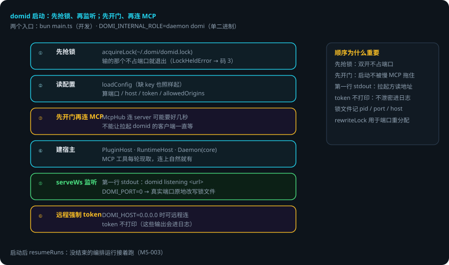
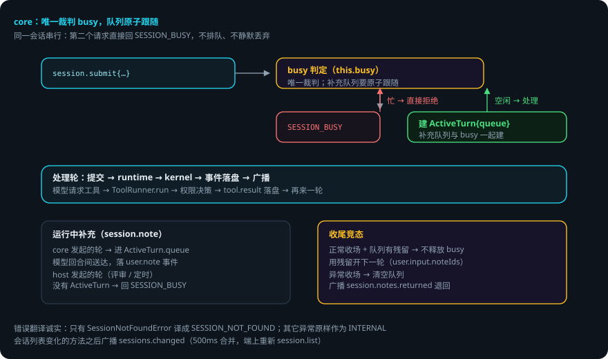

# daemon 内部机制

> 本页回答四个问题：domid 启动时先做什么？core 怎么分发请求？同一会话为什么串行？出错了会怎样？
> `packages/daemon` —— 进程宿主。客户端全部经 Domi Protocol 访问它，它是事件流的唯一写入者。
> 贯穿例子：给登录接口加限流——你按了发送，请求从终端到 domid 再到会话，全程经过 core。

## 先说结论

- 启动顺序有讲究：**先抢锁、再监听**；**先开门、再连 MCP**。
- 两个入口：`bun packages/daemon/src/main.ts`（开发），或单二进制里 `DOMI_INTERNAL_ROLE=daemon domi`。
- core 只管分发与串行，传输（WS / stdio）在 transport 层——并发正确性只在一个地方证明。
- **同一会话串行**：第二个请求直接回 `SESSION_BUSY`，不排队、不静默丢弃。
- 运行中补充的队列在 core：为每个轮建 `ActiveTurn`，「忙不忙」的裁判是 core 的 `busy`。
- 远程可连时强制 token；token 不打印（这些输出会进日志）。

## 用到的词

| 词 | 意思 |
|---|---|
| core | daemon 的 JSON-RPC 分发与串行调度。 |
| transport | 传输层：搬字节（WS / stdio），不归 core 管。 |
| ActiveTurn | core 为每个轮建的运行状态（含补充队列）。 |
| 补充 | 轮进行中用户追加的内容（session.note）。 |
| 锁文件 | `~/.domi/domid.lock`：防两个 domid 同时跑。 |

## 1. 启动顺序

`main.ts` 的启动顺序，每一步都有理由：

1. **先抢锁、再监听**：`acquireLock(~/.domi/domid.lock)`——两个同时启动的进程里输的那个不会先占端口才发现自己不该起（`LockHeldError` → 退出码 3）。
2. 读配置（缺 key 也照样起）、定 domid 自己的语言、算 server 设置（端口 / host / token / allowedOrigins）。
3. **先开门再连 MCP**：`McpHub` 连 server 可能要好几秒（各自超时），不能让拉起 domid 的客户端一直等；工具每轮现取，连上之后自然就有了。
4. 建 `PluginHost`（沙箱 / 无沙箱）、`RuntimeHost`（把每个 DomiSession 接到 core 上）、`Daemon`（core）。
5. `serveWs` 监听。**第一行 stdout 是 `domid listening <url>`**——拉起它的客户端读这一行拿地址。`DOMI_PORT=0` 时拿到真实端口后原地改写锁文件。
6. 远程可连（`DOMI_HOST=0.0.0.0`）时强制 token；token 不打印（这些输出会进日志）。

## 2. core：分发与串行（无传输细节）

core 进来的是 JSON-RPC 请求对象、出去的是响应对象；WS 还是 stdio 由 `transport-ws.ts` 负责。这样拆是因为**并发与顺序的正确性只能在一个地方证明**——两套传输不需要两套调度。

两条硬规则：

1. **daemon 是事件流的唯一写入者**。客户端只提交意图。
2. **同一会话串行**。第二个请求进来不排队也不静默丢弃，直接回 `SESSION_BUSY`。

关键点：

- `DaemonHost` 接口：core 只认这个接口（测试注入假的），生产实现是 `runtime-host.ts` 的 `RuntimeHost`。
- **错误翻译**：只有 `SessionNotFoundError` 会翻译成 `SESSION_NOT_FOUND`；其它异常（配置坏了、库打不开）原样作为 `INTERNAL`——把一切打不开都说成「没有这个会话」，用户会去找一个本来就存在的东西。
- 会话列表变化的方法（create / delete / restore / rename / branch / toTask / task.create / review.start / schedule.runNow）之后广播 `sessions.changed`。
- **运行中补充的队列在 core**（M13 取舍-1）：core 为每个由它发起的轮建 `ActiveTurn { queue, ac }`。「会话忙不忙」的唯一裁判是 core 的 `busy`，队列要跟这个判断**原子**地一起做，否则有两个窗口会丢补充。host 自己发起的轮（评审会话、定时任务节点）没有 ActiveTurn，`session.note` 回 `SESSION_BUSY`。
- **收尾的竞态**：正常收场（`stopReason === 'completed'`）时队列还有残留 → 不释放 busy，用残留开下一轮（`user.input.noteIds` 带上）；异常收场 → 清空队列并广播 `session.notes.returned`。

## 3. runtime-host：真宿主

- 每个会话一个 `DomiSession`，共用同一个 SQLite 文件（`~/.domi/events.db`）；会话列表由宿主自己的一条连接读。
- 权限询问经 core 推给客户端（`session.ask`），由任一客户端回答（`session.answer`）。没有客户端在线时任务就停在询问上等——「断开不影响任务」：执行一个需要确认的操作，本来就该等人，而不是替人答。
- `extraTools` 每轮现取：MCP 工具 + 插件工具（停用插件带的 MCP server 已连上的工具在此滤掉，启停即时生效）。
- daemon 启动后调 `resumeRuns`：没结束的编排运行接着跑。

## 4. 调度器与定时任务

`scheduler.ts` + `cron.ts`：5 段 cron（分 时 日 月 周，支持 `*` `,` `-` `/` 与英文缩写；不支持 `L` `W` `#` 与秒），时区用 Intl 换算不引依赖。调度器在 domid 进程里跑，时钟与定时器都注入（测试用假时钟）；每次醒来对每个计划看「不晚于现在的最近应触发时刻」是否晚于 `last_due`，是就触发一次（错过多个周期也只补这一次）。应触发时刻之后 60 秒内算准点，超过算 `late`（domid 没开、机器睡着了）。详见[定时任务](scheduling.md)。

## 5. 出错了怎么办：限流第 2 步进行中，你按了「发送」想追加一句话

1. **会话正忙**。core 的 `busy` 为真 → 你的 `session.submit` 直接回 `SESSION_BUSY`。不排队、不静默丢弃——你看到明确错误，知道没发出去。
2. **运行中补充**。你走 `session.note`（不是 submit）→ 进 `ActiveTurn.queue`，本轮模型回合间送达，落 `user.note` 事件。
3. **正常收场时队列有残留**。不释放 busy，用残留开下一轮（`user.input.noteIds` 带上）——你的补充不会丢。
4. **异常收场**。清空队列并广播 `session.notes.returned`——端上把你的补充退回来。
5. **两个 domid 同时启动**。输的那个 `LockHeldError` → 退出码 3，不占端口。
6. **daemon 重启**。`resumeRuns` 把没结束的编排运行接着跑；事件全在库里。

### 一张表看全部情况

| 情况 | domi 做什么 | 你要做什么 |
|---|---|---|
| 会话忙（你 submit） | 回 SESSION_BUSY | 稍后再试 |
| 会话忙（你 note） | host 发起的轮：回 SESSION_BUSY；core 发起的轮：进 ActiveTurn.queue | 不用管 |
| 正常收场有残留补充 | 不释放 busy，用残留开下一轮 | 不用管 |
| 异常收场 | 清空队列，广播 session.notes.returned | 重新提交补充 |
| 双开 domid | 输的退出码 3 | 不用管 |
| daemon 重启 | resumeRuns 续跑未结束的编排 | 不用管 |

## 6. 可靠性靠什么

1. **先抢锁再监听**。双开时输的那个在占端口前就退出。
2. **先开门再连 MCP**。启动不被慢 MCP 拖住。
3. **串行在一个地方证明**。core 唯一裁判 busy，队列原子跟随。
4. **错误翻译诚实**。只有会话不存在才说 SESSION_NOT_FOUND，其它异常如实报 INTERNAL。
5. **时钟注入**。调度器测试用假时钟，时间逻辑可确定性地测。
6. **补充不丢**。残留队列开下一轮 / 异常退回，两条路都有交代。

## 已知限制

- 同一会话串行：同一时刻一个会话只处理一个请求。
- host 自己发起的轮（评审、定时任务）没有 ActiveTurn：`session.note` 回 `SESSION_BUSY`。
- cron 不支持 `L` `W` `#` 与秒（5 段）。错过多个周期只补一次。
- token 强制只发生在远程可连时；本地 stdio 不需要。

## 代码在哪里

| 主题 | 位置 |
|---|---|
| 启动顺序 / 锁 / 端口 | `packages/daemon/src/main.ts` |
| JSON-RPC 分发与串行 | `packages/daemon/src/core.ts` |
| 会话宿主接线 | `packages/daemon/src/runtime-host.ts` |
| 锁文件 | `packages/daemon/src/lock.ts` |
| WS 传输 | `packages/daemon/src/transport-ws.ts` |
| 调度器 / cron | `packages/daemon/src/{scheduler,cron}.ts` |
| 鉴权 / token | `packages/daemon/src/auth.ts` |

测试：`packages/daemon/test/`（core 单测、transport 测试、调度器测试）。

## 相关

- 协议方法由 core 分发：[Domi Protocol：daemon 与客户端之间的契约](protocol.md)。
- 会话的装配与提交：[Agent Loop：一轮里发生了什么](agent-loop.md)。
- 定时任务的补触发与错过窗口：[定时任务](scheduling.md)。
