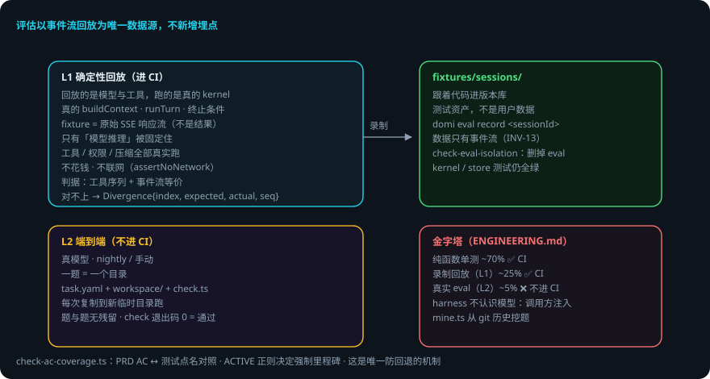

# 评估体系 L1 / L2

> 本页回答四个问题：怎么证明「没改坏」？怎么证明「真能干活」？测试金字塔什么样？回放怎么不花钱不联网？
> `packages/eval`。
> domi 的立场：**评估以事件流回放为唯一数据源，不新增埋点**；L1 是 CI 门禁，L2 只进 nightly / 手动。
> 贯穿例子：给登录接口加限流——改完权限逻辑，先跑 L1 回放证明没改坏，再跑 L2 验证真能干活。

## 先说结论

- **L1 = 确定性回放**（可进 CI）：回放的是模型与工具，跑的是真的 kernel——不花钱、不联网。
- **L2 = 端到端**（真模型，不进 CI）：一题 = 一个目录，每次复制到新临时目录跑，题与题没有残留。
- 判据：工具调用序列 + 事件流等价；对不上时给出 `Divergence{index, expected, actual, seq}`。
- fixture 存模型的**原始 SSE 响应流**，不是最终结果——只有「模型推理」被固定住，其它全真实跑。
- 删除 `packages/eval` 后 kernel / store 测试仍全绿（INV-13 的守卫）。
- 测试金字塔：单测 ~70% / 回放 ~25% / 真实 eval ~5%。

## 用到的词

| 词 | 意思 |
|---|---|
| 回放 | 用录制的模型响应重跑真实 kernel。 |
| fixture | 录制的原始 SSE 响应流（测试资产）。 |
| L1 | 确定性回放，进 CI 门禁。 |
| L2 | 端到端真模型，只进 nightly / 手动。 |
| Divergence | 回放对不上的位置（第几次调用）。 |

## 1. 总体流程

## 2. L1：确定性回放（可进 CI）

`eval/src/replay.ts`：

- **回放的是模型与工具，跑的是真的 kernel**：真的 `buildContext`、真的 `runTurn`、真的终止条件、真的事件流——能抓到「改了 prompt 之后工具调用顺序变了」这类回归。
- **不花钱、不联网**：回放期间任何出站调用都让测试失败（`assertNoNetwork`）；fixture 存模型的原始 SSE 响应流，不是最终结果。
- 判据：工具调用序列 + 事件流等价；从第几次开始对不上给出 `Divergence{index, expected, actual, seq}`。
- 命令：`domi eval run`（CI 里 `pnpm eval`）；`domi eval record <sessionId>` 录制（数据只有事件流）。
- **删除测试**：删掉 `packages/eval` 后 kernel / store 测试仍全绿（INV-13 的守卫方式，`check-eval-isolation.ts`）。

## 3. L2：端到端（真模型，不进 CI）

`eval/src/l2.ts`：L1 证明「没改坏」，L2 证明「真能干活」。

- 一题 = 一个目录：`task.yaml`（提示与允许的能力）+ `workspace/`（初始文件）+ `check.ts`（判据，退出码 0 = 通过）。题在 `eval/l2/`。
- 每次都复制到新的临时目录跑，题与题、次与次之间没有残留。
- harness 不认识模型：怎么跑一轮由调用方注入（CLI 用真实的 runtime，测试用替身）。
- `mine.ts`：从 git 历史挖题（会写代码的评估源）。

## 4. 三层测试金字塔

| 层 | 占比 | 确定性 | 进 CI？ |
|---|---|---|---|
| 纯函数单测 | ~70% | 完全确定 | ✅ |
| 录制回放（ReplayProvider / L1） | ~25% | 确定 | ✅ |
| 真实 eval（L2） | ~5% | 非确定 | ❌（nightly / 手动，看趋势文件） |

## 5. 出错了怎么办：L1 回放对不上了

1. **工具调用顺序变了**。`Divergence{index, expected, actual, seq}`——从第几次开始对不上。`seq` 直接跳到轨迹面板对应节点，看哪一步变了。
2. **回放期间有出站调用**。`assertNoNetwork` 让测试失败。查是不是 fixture 依赖了网络（fixture 只存 SSE 流，不该有别的出站）。
3. **改了 prompt 导致行为变化**。这正是 L1 要抓的：改 prompt 是行为变更，先想清楚要不要改 fixture。
4. **L2 题挂了**。check.ts 退出码非 0。在临时目录里重跑，看 workspace 状态——每次都是干净的。
5. **录制数据缺失**。`domi eval record` 的数据只有事件流；缺埋点说明事件没录全。

### 一张表看全部情况

| 情况 | domi 做什么 | 你要做什么 |
|---|---|---|
| 回放对不上 | 给 Divergence（index/seq） | 用 seq 跳轨迹节点排查 |
| 有出站调用 | assertNoNetwork 失败 | 查 fixture 依赖 |
| prompt 改了行为 | L1 抓住差异 | 决定改代码还是改 fixture |
| L2 题挂 | check.ts 非 0 | 临时目录重跑排查 |
| 录制缺数据 | — | 检查事件是否录全 |

## 6. 可靠性靠什么

1. **事件流是唯一数据源**：评估与轨迹同一份数据，不新增埋点。
2. **只固定模型推理**：工具、权限、压缩全部真实跑——回归抓得到。
3. **无网保证**：出站调用直接失败，CI 里不会偷偷联网。
4. **隔离**：L2 每次新临时目录，题与题无残留。
5. **可删除**：eval 包删掉其它测试仍绿，它不绑架系统。
6. **AC 对照**：`check-ac-coverage.ts` 把 PRD AC ↔ 测试点名对照——唯一防回退机制。

## 已知限制

- L2 非确定：真实模型有波动，只进 nightly / 手动。
- fixture 需要维护：prompt / 行为变更后可能要重录。
- 回放只固定「模型推理」：其它环节仍受环境影响。
- `mine.ts` 挖题依赖 git 历史质量。

## 代码在哪里

| 主题 | 位置 |
|---|---|
| L1 回放 | `packages/eval/src/replay.ts` |
| L2 端到端 | `packages/eval/src/l2.ts` |
| 挖题 | `packages/eval/src/mine.ts` |
| 隔离守卫 | `scripts/check-eval-isolation.ts` |
| AC 对照 | `scripts/check-ac-coverage.ts` |
| L2 题 | `eval/l2/` |

## 相关

- 轨迹与回放的关系：[轨迹与回放](trajectory-and-replay.md)。
- 修 bug 的流程：先写能复现的失败测试 → 再修（ENGINEERING.md 硬规则）。
- 命令面：`domi eval run / record` 见 [CLI 与命令](cli.md)。
