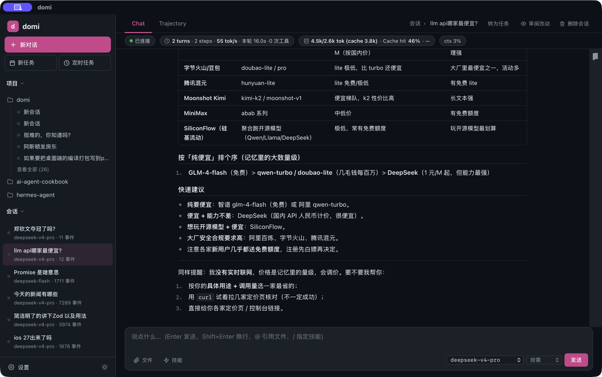

# domi 是什么

> 面向第一次接触 domi 的人：它能帮你做什么、为什么能放心交给它、现在有哪些限制。
> 想直接上手看[快速开始](quickstart.md)；想了解内部怎么工作看[架构](architecture.md)。

## 先说结论

- domi 是一个**通用 AI Agent，正在向 personal Agent 进化**。
- 它能帮你处理复杂任务：会做计划、懂编排，可中断、可恢复，每一步可跟踪、可追溯。
- 场景包括但不限于编程、设计、办公。
- 你可以定义它的人格。它在和你的相处中学习，越来越懂你。
- 数据仅存在你自己的电脑上。写文件、跑命令、联网，你放行了它才做。

## 它能帮你做什么

| 场景 | 例子 |
|---|---|
| 编程 | 读代码、改代码、跑测试。大一点的任务放在单独的工作区里做，你看过改动再带回原仓库 |
| 设计 | 整理需求、写设计说明、做页面原型 |
| 办公 | 整理资料、批量处理文件、写报告。接上 MCP 服务或 Skill，能用上更多工具 |
| 定时的活 | 按时间表自动跑，比如每天早上汇总一遍 |
| 长任务 | 关掉终端也接着跑；中途停了，回来接着做 |

## 为什么能放心交给它

### 会计划，懂编排

domi 先列计划，再动手。复杂任务拆成几步，按先后依赖排好再执行。做到哪一步、还剩哪几步，你随时能看到。

### 可中断，可恢复

- 它干活时，你可以接着打字补充要求。补充会排队，在下一步送达。
- 你可以随时叫停：Web 点「停止」，终端按 `Esc`。停下的只是这一轮，已经生成的内容保留。
- 出错停下后，计划和做完的部分都还在。点「继续」（或输入 `/continue`）就接着做。
- domi 不会替你自动重跑做了一半的操作。要不要继续，由你决定。

### 可跟踪，可追溯

每一步想了什么、调了什么工具、你批准了什么，都有记录。做的时候在侧栏看进度和改动；做完能回放整个过程，找到是哪一步出了问题。

### 可以定义人格，越来越懂你

domi 的人格是一份你能直接读、直接改的文档：

- 你可以一开始就写好它该是什么样。
- 它在和你的相处中学习。新学到的每一条都先给你看，你接受或否决（`/soul`）。否决的不会再提。
- 你手改过的内容，它不会覆盖。
- 人格可以导出成一个文件，分享给别人用。

### 数据仅存本地，隐私无忧

- 会话、记忆、人格都存在你自己的电脑上，只发给你配置的模型。
- 写文件、跑命令、联网、用外部工具，你放行了它才做。
- 你可以选每次都问、按规则问，或者全部放行（`/mode`）。

### 模型随你选

OpenAI、Anthropic、DeepSeek、Gemini，本地模型（Ollama），或者网关（LiteLLM、OpenRouter）。对话中途也能换（`/model`）。

## 在哪儿用

| 入口 | 适合 | 现在怎么用 |
|---|---|---|
| 终端 | 习惯命令行、远程机器上 | 下载二进制，输入 `domi` |
| Web | 想要完整界面、看改动和进度 | 从源码运行 |
| 桌面应用 | macOS 上当普通应用用 | 从源码构建 |

三个入口看到的是同一批会话。在终端开始的事，可以在 Web 里接着看。

## 已知限制

- 目前安装和使用需要会用终端；支持 macOS 和 Linux，Windows 请用 WSL。
- Web 和桌面端还要从源码运行，计划改成下载就能用。
- 还不能直接操作浏览器和桌面应用。设计、办公类任务目前靠读写文件、跑命令、MCP 和 Skill 完成。
- macOS 二进制还没有签名，第一次运行前要解除隔离（见[快速开始](quickstart.md)）。

## 下一步

- 想马上跑起来：[快速开始](quickstart.md)
- 接模型、改配置：[配置与厂商](config.md)
- 想给它加东西：[插件开发](plugin-dev.md) · [Skill 编写](skill-writing.md)
- 想了解内部怎么工作：[架构](architecture.md)
