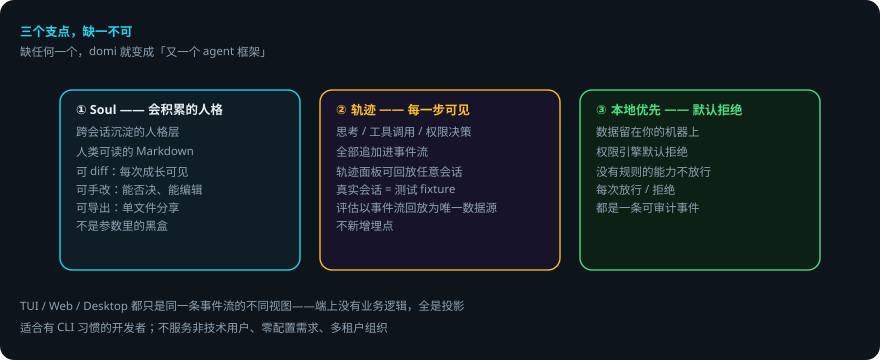

# domi 是什么

> 面向第一次接触 domi 的人：它解决什么问题、和别的 agent 工具有什么不同、你能拿它干什么。
> 想直接上手看[快速开始](quickstart.md)；想读架构看[架构](architecture.md)。

## 先说结论

- domi 是一个**本地 Agent 运行时**：对话、工具调用、权限决定全部记成一条只追加的事件流。
- 它**不是黑盒**：每一步思考都可见、可回放、可审计。
- 三个支点缺一不可：**Soul（会积累的人格）**、**轨迹（每一步可见）**、**本地优先（默认拒绝）**。
- 数据留在你自己的机器上；权限引擎默认拒绝，每次放行 / 拒绝都是一条可审计事件。
- 三端（TUI / Web / Desktop）只是同一条事件流的不同视图。

## 一句话

**domi 是一个会积累「人格」的、你能看见它每一步在想什么的本地 Agent 运行时。**

## 三个支点

缺任何一个，domi 就变成「又一个 agent 框架」：

### 1. Soul —— 会积累的人格

跨会话沉淀的人格层。它不是藏在参数里的黑盒，而是一份**人类可读的 Markdown**：

- 可 diff：每一次成长都能看到改了什么
- 可手改：你能否决、能编辑它
- 可导出分享：单文件导出，别人 import 后能复现你的行为差异

### 2. 轨迹 —— 每一步都可见

思考、工具调用、权限决策都是追加进事件流的事件。轨迹面板可以**回放任意一次会话**——甚至真实会话可以直接当作测试 fixture 重放（评估不新增埋点，以事件流回放为唯一数据源）。

### 3. 本地优先 —— 默认拒绝

- 你的数据留在你的机器上，不上云
- 权限引擎**默认拒绝**：没有规则的能力不放行
- 每一次放行/拒绝都是一条可审计事件

## 你能拿它干什么

- **日常开发任务**：读代码、改代码、跑测试的完整闭环，全部在终端里可见
- **长任务**：任务在 daemon 里跑，关掉终端也继续；重启后从上次完成的节点接着跑
- **多模型**：多家供应商、本地模型（Ollama）或网关（LiteLLM / OpenRouter）切换
- **定时任务**：cron 调度，在 domid 里托管
- **扩展**：插件（tool / skill / mcp / ui）、MCP 接入、Skill 编写

## 三端，同一件事

TUI（全屏终端）、Web（浏览器）、Desktop（桌面应用）都只是同一条事件流的不同**视图**——端上没有业务逻辑，全是投影。同一批会话，三端共享。

## 适合谁

- 主：**有 CLI 习惯的开发者**，愿意为可控性接受配置成本，对「黑盒 agent」有戒心
- 次：想自建 agent 工作流的技术团队

domi **明确不服务**：非技术用户、需要开箱即用零配置的人、需要多租户/团队协作的组织。

## 下一步

- 想马上跑起来：[快速开始](quickstart.md)
- 想了解内部怎么工作：[架构](architecture.md) → [Agent Loop 内部机制](agent-loop.md)
- 想给它加东西：[插件开发](plugin-dev.md) · [Skill 编写](skill-writing.md)
