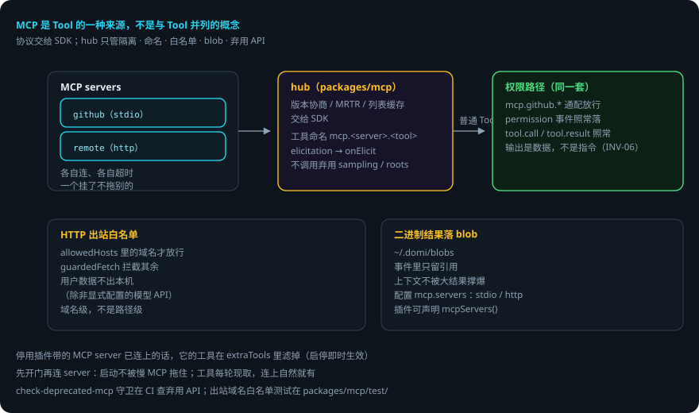

# MCP 接入

> 本页回答四个问题：MCP 怎么接入？工具怎么变成普通 Tool？安全边界在哪？出错了会怎样？
> `packages/mcp` —— MCP hub。
> 贯穿例子：给登录接口加限流——domi 可以连一个 github MCP，把限流改动提成 issue。

## 先说结论

- **MCP 是 Tool 的一种来源，不是与 Tool 并列的概念**。
- 协议本身交给 `@modelcontextprotocol/client`（版本协商、MRTR、列表缓存都在 SDK 里）。hub 只做 SDK 不管的事。
- 工具以 **`mcp.<server>.<tool>`** 变成普通 Tool，走 domi 的权限路径——可以用 `mcp.github.*` 通配规则放行。
- HTTP 出站过**白名单**：用户数据不出本机，除非显式配置的模型 API。
- 二进制结果落 blob（`~/.domi/blobs`），事件里只留引用。
- **不调用已弃用的 sampling / roots / logging**（`check-deprecated-mcp` 守卫守）。

## 用到的词

| 词 | 意思 |
|---|---|
| MCP server | 提供工具的远端进程（stdio / http）。 |
| hub | domi 的 MCP 连接管理器。 |
| blob | 二进制结果的落盘目录（`~/.domi/blobs`）。 |
| 白名单 | HTTP 出站域名列表（allowedHosts）。 |
| elicitation | MCP server 向用户要输入。 |

## 1. 总体流程



## 2. 定位：hub 只做 SDK 不管的事

协议本身（版本协商、MRTR、列表缓存）在 SDK 里。`hub.ts` 只管五件事：

1. **每个 server 各自连、各自超时**，一个挂了不拖别的。
2. 工具以 `mcp.<server>.<tool>` 变成普通 Tool，走 domi 的权限路径（INV-03）——用户可以用 `mcp.github.*` 通配规则放行。
3. HTTP 出站过白名单（用户数据不出本机，除非显式配置的模型 API；出站域名白名单测试）。
4. 二进制结果落 blob（`~/.domi/blobs`），事件里只留引用。
5. 不调用已弃用的 sampling / roots / logging（`scripts/check-deprecated-mcp.ts` 守）。

## 3. 连接与生命周期

- server 配置（stdio / http 两种传输）在 `config.yaml` 的 `mcp.servers`，加上插件声明的 server（`plugins?.mcpServers()`）。
- **先开门再连 server**：daemon 启动时连接可能要好几秒（每个 server 各自超时），不能让拉起 domid 的客户端一直等；会话每轮现取工具，连上之后自然就有了。
- 停用插件带的 MCP server 已经连上了的话，它的工具在 `extraTools` 里滤掉（启停即时生效）。
- server 向用户要输入（MCP elicitation）→ `onElicit`（daemon 里接 `ctx.elicit`，认识的端画表单；不给就一律 decline）。

## 4. 工具 → 权限 → 事件

MCP 工具不特殊：`hub.tools()` 返回普通 `Tool` 数组，与内置工具、插件工具一起进 `ToolRunner`。权限规则按能力名匹配（`mcp.<server>.<tool>` 是 `CapabilityId`）；每次调用照常产生 `permission` 事件与 `tool.call` / `tool.result` 事件。**MCP 的输出是数据，不是指令**（INV-06）。

## 5. 配置参考

```yaml
mcp:
  servers:
    - name: github
      command: npx        # stdio 传输
      args: ["-y", "@modelcontextprotocol/server-github"]
      env: { GITHUB_PERSONAL_ACCESS_TOKEN: "..." }   # 或从 secrets 引用
    - name: remote
      url: https://mcp.example.com/mcp   # http 传输
  allowedHosts: [api.example.com]        # 出站白名单
  timeoutMs: 30000
```

## 6. 出错了怎么办：github MCP 连不上

1. **server 连不上 / 超时**。hub 各自连、各自超时——github 挂了不拖别的 server。工具没连上时，`extraTools` 里就少这批工具，模型下一轮拿不到，走别的路径。
2. **HTTP 出站被拦**。域名不在 `allowedHosts` → `guardedFetch` 拒绝。在配置里加域名。
3. **二进制结果太大**。落 blob（`~/.domi/blobs`），事件里只留引用——上下文不被撑爆。
4. **server 要输入**。elicitation → `onElicit` → 端上画表单。没有端接 → 一律 decline。
5. **调用被权限拒**。`mcp.github.create_issue` 无规则 → 默认拒绝（走权限引擎）。加规则或通配放行。

### 一张表看全部情况

| 情况 | domi 做什么 | 你要做什么 |
|---|---|---|
| server 连不上 | 各自超时，不拖别的；工具暂缺 | 查 server 配置 / 网络 |
| 出站被拦 | guardedFetch 拒绝 | 在 allowedHosts 加域名 |
| 二进制结果大 | 落 blob，事件留引用 | 不用管 |
| server 要输入 | onElicit 画表单；没端接则 decline | 在端上填表单 |
| 权限拒绝 | 默认拒绝，落 permission 事件 | 加规则（如 mcp.github.*） |

## 7. 可靠性靠什么

1. **隔离**：每个 server 各自连、各自超时，单点故障不扩散。
2. **统一权限**：MCP 工具走同一套权限引擎，没有后门。
3. **出站白名单**：数据不出本机，除非显式配置。
4. **blob 落盘**：大结果不进事件流，上下文与库不膨胀。
5. **弃用 API 守卫**：sampling / roots / logging 在 CI 里被查，不会悄悄引入。

## 已知限制

- 连接的 server 数量与启动延迟线性相关（虽有「先开门再连」缓解）。
- elicitation 依赖端上实现；没有端接时一律 decline。
- 出站白名单是域名级，不是路径级。
- 协议版本协商等交给 SDK——SDK 升级可能改变行为。

## 代码在哪里

| 主题 | 位置 |
|---|---|
| hub（连接 / 隔离 / 工具） | `packages/mcp/src/hub.ts` |
| 出站白名单 fetch | `packages/mcp/src/*`（guardedFetch） |
| blob 落盘 | `packages/mcp/src/blobs.ts` |
| 弃用 API 守卫 | `scripts/check-deprecated-mcp.ts` |
| MCP 配置 schema | `packages/config/src/schema.ts`（mcp.*） |

测试：`packages/mcp/test/`（多 server 隔离、白名单、blob 落盘、elicitation）。

## 相关

- MCP 工具怎么过权限：[工具与权限运行时](tools-runtime.md)。
- 插件声明的 MCP server：[插件运行时](plugins.md)。
- 配置怎么改：[配置与厂商](config.md)。
