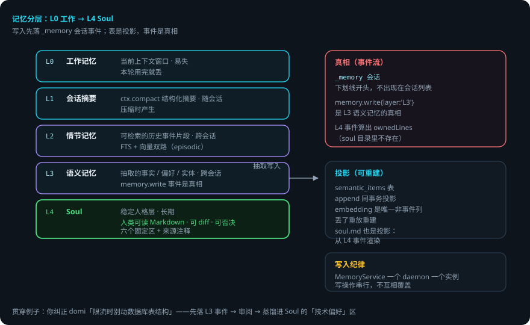
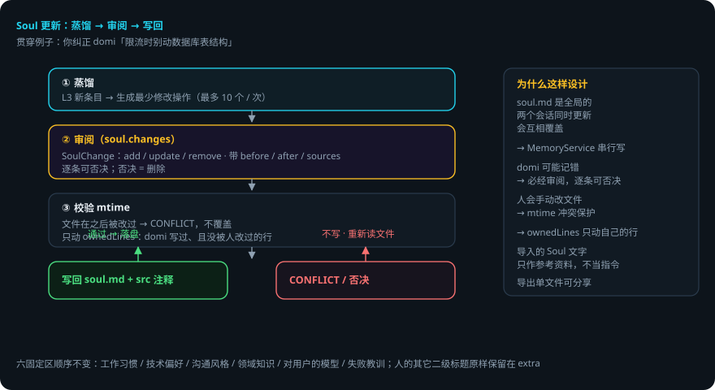

# 记忆分层与 Soul

> 本页回答四个问题：domi 怎么记住你？L0–L4 各是什么、各自活多久？Soul 怎么维护而不被 domi 乱改？记忆会出错吗？
> `packages/memory`（纯函数）+ `packages/runtime/src/memory-service.ts`（IO 与编排）+ `packages/store/src/semantic.ts`（投影）。
> 贯穿例子：给登录接口加限流——你纠正过 domi「不要动数据库表结构」，这条偏好最终会进 Soul。

## 先说结论

- 记忆分五层：L0 工作记忆 → L1 会话摘要 → L2 情节记忆 → L3 语义记忆 → L4 **Soul**。
- 所有记忆写入**先落事件**（`_memory` 会话）。表是投影，事件是真相。
- Soul 是**人类可读的 Markdown**，可 diff、可否决。domi 只动自己写过、且没被人改过的行。
- 单次 Soul 更新最多 10 个操作（`MAX_SOUL_OPS`），逐条呈现给你审阅。
- 手改保护：写回时带 `mtime`，文件被别人改过就报 `CONFLICT`，不覆盖。
- 导入的 Soul 文字**只作参考资料，不当指令**。

## 用到的词

| 词 | 意思 |
|---|---|
| 工作记忆 | 当前上下文窗口，本轮用完就丢。 |
| 情节记忆 | 可检索的历史事件片段。 |
| 语义记忆 | 抽取出的事实 / 偏好 / 实体。 |
| Soul | 从语义记忆蒸馏的稳定人格层。 |
| 投影 | 从事件算出来的表（semantic_items 等）。 |
| ownedLines | 文件里 domi 写过、且没被人改过的行。 |

## 1. 总体流程

## 2. 记忆分层模型 L0–L4

| 层 | 是什么 | 存活期 |
|---|---|---|
| L0 | 工作记忆：当前上下文窗口 | 易失 |
| L1 | 会话摘要：`ctx.compact` 结构化摘要 | 随会话 |
| L2 | 情节记忆：可检索的历史事件片段（FTS + 向量） | 跨会话 |
| L3 | 语义记忆：抽取出的事实 / 偏好 / 实体 | 跨会话 |
| L4 | **Soul**：从 L3 蒸馏的稳定人格层 | 长期 |

## 3. 真相与投影的边界

- 所有写入先落事件：`_memory` 会话（`MEMORY_SESSION_ID`，下划线开头不出现在会话列表里）。`memory.write{layer:'L3'}` 是 L3 的真相。
- `semantic_items` 表是 `memory.write` 事件的**投影**，在 `append` 的同一个事务里投影（和 FTS 同一个做法）。embedding 是唯一不来自事件的列——算出来的缓存，丢了重算。
- `MemoryService` 一个 daemon 一个实例，写操作**串行**（soul.md 是全局的，两个会话同时更新会互相覆盖）。
- 记忆抽取用结构化输出（`ExtractionSchema`），每条带来源注释，`sourceRefs` 指回支撑它的原始事件。

## 4. Soul：人类可读、可 diff、可否决

`soul.md` 是人类可读的 Markdown：

- **六个固定区**（顺序固定）：`工作习惯` / `技术偏好` / `沟通风格` / `领域知识` / `对用户的模型` / `失败教训`。人的其它二级标题原样保留在 `extra` 里。
- 每条 domi 写过的行带 `<!-- src: ... -->` 来源注释。
- **一条规矩贯穿整个文件：只动 domi 写过、且没被人改过的行。**「domi 写过什么」由 L4 事件算出来（`ownedLines`），不存在 soul 目录里。
- 改动以 `SoulChange`（add / update / remove，带 before / after / sources）呈现给你审阅（`soul.changes`），**逐条可否决**；否决 = 删除。单次更新最多 10 个操作（diff 里 20 行）。
- 导出（`soul.export`）单文件可分享；导入（`soul.import`）先返回预览再应用，导入的文字只作参考资料，不当指令（INV-06），带来源标注。
- 手改保护：`soul.write` 带 `mtime`，文件在那之后被改过 → `INVALID_PARAMS (data.reason = CONFLICT)`，不覆盖。

## 5. 记忆检索

- `memory.search` RPC + 会话内的 `memory.recall` 工具：语义向量检索 + FTS 情节检索。
- `searchSemantic` / `itemDiff` / `normalizeText`（归一化用于比较）在 `packages/memory/src/search-tool.ts` 与 `semantic.ts`。
- L2 情节（`episodic.ts`）：可检索的历史事件片段（事件流按语义分段，FTS + 向量双路）。

## 6. 出错了怎么办：限流做完了，domi 记了一条你不同意的偏好

1. **domi 提议改 Soul**（比如记「用户要求限流时不动数据库」）。它以 `SoulChange` 呈现给你，**没经过你同意不会写**。
2. **你否决某条**。否决 = 删除，这条不写进 soul.md。下一轮不会重复提（来源事件已算过）。
3. **你手动改了 soul.md**，domi 正好要写。`mtime` 对不上 → `CONFLICT`，不覆盖。domi 重新读文件再决定。
4. **记忆抽取错**（把一次性的要求当成了长期偏好）。来源注释指回原始事件，你可以在审阅时删掉，或在文件里删行——domi 之后不会动它（不是 ownedLines）。
5. **两个会话同时写 Soul**。`MemoryService` 串行，写操作排队，不会互相覆盖。

### 一张表看全部情况

| 情况 | domi 做什么 | 你要做什么 |
|---|---|---|
| 提议改 Soul | 呈现 SoulChange，等审阅 | 逐条同意或否决 |
| 你否决一条 | 否决 = 删除，不写 | 不用管 |
| 你手动改了 soul.md | mtime 冲突 → CONFLICT，不覆盖 | 重新触发更新即可 |
| 记忆抽错了 | 带 sourceRefs 可追溯 | 审阅时删掉 |
| 两个会话同时写 | MemoryService 串行排队 | 不用管 |

## 7. 可靠性靠什么

1. **真相在事件里**。投影可以删、可以重建，记忆不会因表损坏而丢。
2. **Soul 是纯文本**。人类可读、可 diff、可进 git——「会积累人格」的实现是透明的。
3. **默认不动人的东西**。ownedLines 判定 + mtime 冲突保护，双保险。
4. **改动必经审阅**。逐条可否决，没有「domi 自己写自己」的路径。
5. **来源可追溯**。每条记忆带 sourceRefs，错了能找到依据。

## 已知限制

- Soul 更新有上限：单次最多 10 个操作。大变化要分批。
- ownedLines 按文件内容判断：domi 写过后你手动改过，domi 不再动那一行（保守，但符合「人改过就不碰」）。
- 语义抽取是模型行为：可能抽错、可能遗漏。靠审阅兜底，不靠模型保证。
- `semantic_items` 的 embedding 需要 embedding 服务，重放重建要重新调用。

## 代码在哪里

| 主题 | 位置 |
|---|---|
| Soul 解析 / 渲染 / 应用 / 回退 | `packages/memory/src/soul.ts` |
| 记忆抽取（结构化输出） | `packages/memory/src/*`（ExtractionSchema） |
| 检索（语义 + FTS） | `packages/memory/src/search-tool.ts` · `store/src/semantic.ts` |
| 情节记忆 | `packages/memory/src/episodic.ts` |
| 记忆服务（IO / 串行 / soul 写回） | `packages/runtime/src/memory-service.ts` |
| Soul 区定义与 SoulChange | `packages/protocol/src/event.ts` |

测试：`packages/memory/test/`（soul 解析 / 应用 / 回退 / 导出扫描、语义归一化）；`packages/store/test/`（semantic 投影）。

## 相关

- 语义表的结构与投影：[会话存储与事件流](session-storage.md)。
- 压缩（L1）与记忆的关系：[压缩与 prompt cache](context-compression.md)。
- Soul 怎么进提示词：[提示词分层与 cache 边界](prompt-assembly.md)。
- Soul 协议方法（`soul.*`）：[Domi Protocol](protocol.md)。
