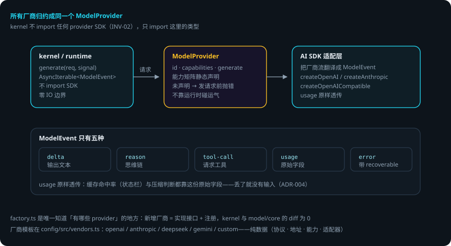

# 模型运行时

> 本页回答四个问题：模型层怎么统一？能力矩阵怎么用？结构化输出和重试怎么兜底？出错了会怎样？
> `packages/model` —— ModelProvider 接口、AI SDK 适配、能力矩阵、结构化输出、重试。
> 贯穿例子：给登录接口加限流——domi 每轮调用模型，输出流式回到事件流。

## 先说结论

- **所有厂商都归约成同一个 `ModelProvider`**。kernel 只认识这一个接口。
- `ModelEvent` 只有**五种**：`delta` / `reason` / `tool-call` / `usage` / `error`。
- **能力矩阵静态声明**：调用未声明的能力在发请求前就抛错，不靠运行时碰运气。
- `providerOptions` 与原始 `usage` **原样透传**——适配层不做字段归一、不丢字段。
- `factory.ts` 是唯一知道「有哪些 provider」的地方：新增厂商只需实现接口 + 注册，kernel 与 model/core 的 diff 为 0。
- 自定义 `fetch` 可注入：企业代理 / mTLS / 测试截流（不能靠改 `globalThis.fetch`——AI SDK 在模块加载时就把它抓走了）。

## 用到的词

| 词 | 意思 |
|---|---|
| ModelProvider | kernel 认识的唯一模型接口。 |
| ModelEvent | 模型输出的统一事件（五种）。 |
| 能力矩阵 | 静态声明的模型能力（toolCall / vision 等）。 |
| 适配器 | 把 AI SDK 的流翻译成 ModelEvent 的层。 |
| 厂商模板 | 纯数据的厂商配置（协议 / 地址 / 能力 / 适配器）。 |

## 1. 总体流程



## 2. ModelProvider：kernel 认识的唯一接口

```ts
interface ModelProvider {
  readonly id: string
  readonly capabilities: ModelCapabilities   // 静态声明的能力矩阵
  generate(req: ModelRequest, signal: AbortSignal): AsyncIterable<ModelEvent>
}
```

kernel 不 import 任何 provider SDK（INV-02），只 import 这里的类型。

`ModelEvent` 五种：

| 类型 | 含义 |
|---|---|
| `delta` | 输出文本增量 |
| `reason` | 思维链文本 |
| `tool-call` | 请求调用工具 |
| `usage` | 用量（原始字段，原样透传） |
| `error` | 错误（带 recoverable 标记） |

两个关键设计：

- **能力矩阵静态声明**（toolCall / vision / reasoning / promptCache / structuredOutput）。调用未声明的能力在发请求前抛错——不靠运行时碰运气。如果模型其实支持（常见于自定义网关），在「设置 › 模型供应商」或 `config.yaml` 的 `providers.${provider}.capabilities` 里显式打开。
- **ADR-004 逃生口**：`providerOptions` 与原始 `usage` 原样透传。缓存命中率（状态栏）与压缩时保住 prompt cache 前缀的判断都靠这份原始 usage——丢了就没有输入。

## 3. 工厂与厂商模板

`factory.ts` 是唯一知道「有哪些 provider」的地方。实现经 AI SDK（`ai-sdk-provider.ts`）：`createOpenAI` / `createAnthropic` / `createOpenAICompatible`。

厂商知识在 `packages/config/src/vendors.ts`（`guard:providers` 扫全仓，SDK 包名只允许出现在 factory.ts）：

| 厂商 | 协议 / 适配 |
|---|---|
| openai | 官方 Responses API |
| anthropic | 官方 |
| deepseek | openai 兼容 |
| gemini | 官方 |
| custom | 自选协议 |

每个模板是纯数据：协议、默认地址、默认能力、惯用环境变量名、用哪种适配器。

- `connectionShape(cfg)`：vendor + protocol + adapter 三者的解析。
- `createProvider(conn, name)`：配置 → Provider 实例；`providerConfigOf` 把 `providerConnection` 变成工厂参数。
- 自定义 `fetch` 的注入点：企业代理 / mTLS / 测试截流。

## 4. 结构化输出与重试

| 模块 | 干什么 |
|---|---|
| `structured.ts` | 统一走 JSON Schema；对不支持 structured output 的模型用「Zod schema → 提示词约束 + 解析重试」兜底，接口对上层一致（`generateStructured` / `StructuredOutputError`） |
| `retry.ts` | 可恢复错误的有限重试（流式中断等） |
| `probe.ts` | `/v1/models` 探测（模型清单自动发现；探测失败用配置里的 `models` 清单兜底） |
| `embedding.ts` | L3 语义记忆的向量嵌入（嵌入不支持 → `EmbeddingUnsupportedError`，语义检索降级 FTS） |
| `stub-provider.ts` | CI 里的模型替身（真实 LLM 调用不进 CI 门禁） |

## 5. 出错了怎么办：限流做到第 2 步，模型流中断了

1. **流式中断**。`retry.ts` 判定为可恢复错误 → 有限重试（有次数上限）。重试仍失败 → 落 `model.delta` 流的 `error` 事件。
2. **调用了未声明的能力**。发请求前抛错——不是等到响应才失败。去配置里显式打开该能力。
3. **嵌入不支持**。`EmbeddingUnsupportedError` → 语义检索降级 FTS 全文检索，记忆功能继续可用。
4. **探测失败**（模型清单发现不了）。用配置里的 `models` 清单兜底。
5. **模型返回不可解析的结构化输出**。`StructuredOutputError` → 按提示词约束重试解析；仍失败则上层按错误处理。

### 一张表看全部情况

| 情况 | domi 做什么 | 你要做什么 |
|---|---|---|
| 流式中断 | 有限重试；仍失败落 error 事件 | 不用管（或看轨迹） |
| 能力未声明 | 发请求前抛错 | 在配置里显式打开 |
| 嵌入不支持 | 降级 FTS | 不用管 |
| 模型清单探测失败 | 用配置 models 兜底 | 在配置里写明 models |
| 结构化输出解析失败 | 重试解析；仍失败按错误处理 | 不用管 |

## 6. 可靠性靠什么

1. **接口单一**。所有厂商归约成一个 ModelProvider，kernel 不用知道厂商差异。
2. **能力静态声明**。错配在发请求前暴露，不是运行中。
3. **usage 原样透传**。缓存命中判断依赖原始字段，透传保证不丢输入。
4. **兜底阶梯**。结构化输出有提示词约束兜底；嵌入有 FTS 兜底；探测有配置兜底。
5. **CI 用替身**。真实 LLM 不进 CI 门禁，测试确定性由 stub-provider 保证。

## 已知限制

- 厂商能力差异靠显式声明解决：声明错了（关掉实际支持的能力）会拒绝可用路径。
- 自定义 fetch 必须走注入点，改 `globalThis.fetch` 无效（AI SDK 模块加载时已抓走）。
- 结构化输出兜底（提示词约束）不保证 100% 解析成功。
- 探测只认 `/v1/models` 形态，非标准网关需配置兜底。

## 代码在哪里

| 主题 | 位置 |
|---|---|
| ModelProvider 接口与 ModelEvent | `packages/model/src/provider.ts` |
| 能力矩阵 | `packages/model/src/capability.ts` |
| AI SDK 适配 | `packages/model/src/ai-sdk-provider.ts` |
| 厂商注册表（唯一） | `packages/model/src/factory.ts` |
| 厂商模板 | `packages/config/src/vendors.ts` |
| 结构化输出 / 重试 / 探测 / 嵌入 | `packages/model/src/{structured,retry,probe,embedding}.ts` |
| CI 模型替身 | `packages/model/src/stub-provider.ts` |

测试：`packages/model/test/`（能力矩阵、结构化输出、重试、factory 注册表；全部打桩）。

## 相关

- 谁消费：kernel 的 loop（`ProviderLike` 结构同构）与 runtime 的 `model-resolve.ts` / `model-catalog.ts`。
- 加一家新厂商：[添加模型供应商](adding-providers.md)。
- 厂商配置怎么改：[配置与厂商](config.md)。
