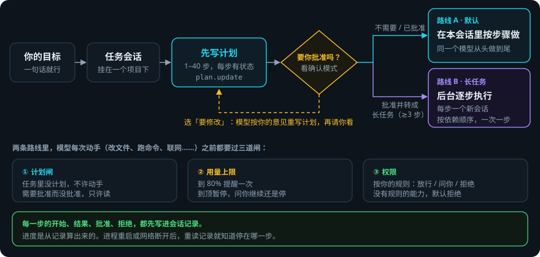
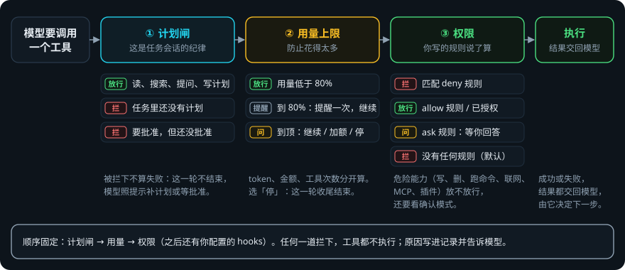
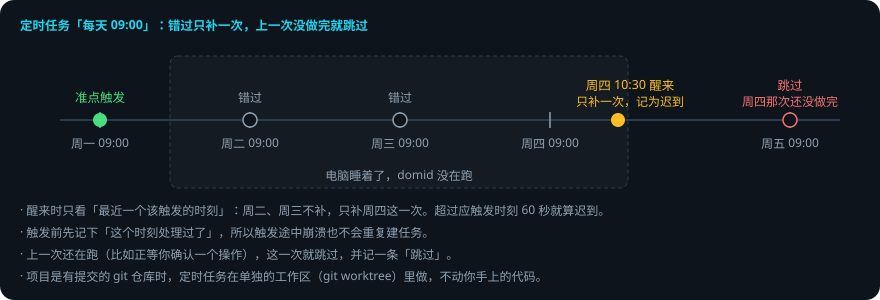
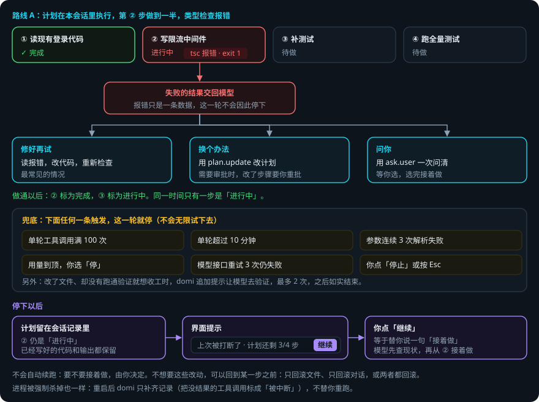
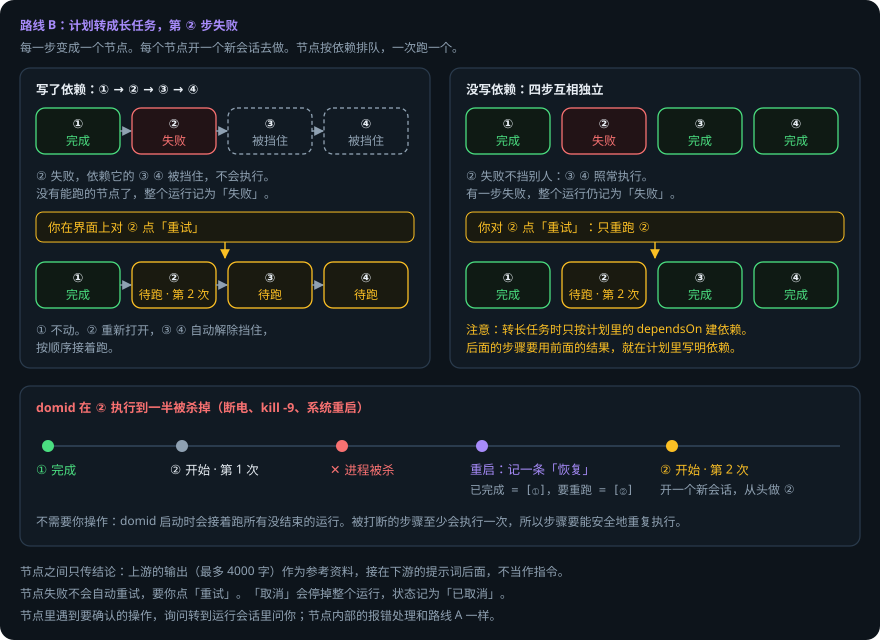

# 编排：计划、长任务与出错恢复

> 本页回答四个问题：domi 怎么把一个目标拆成步骤？谁来批准？一次能跑多久？做到一半出错了怎么办？
> 想亲手试一遍出错的情况，打开 **[交互演示](orchestration-explainer.html)**：选一种故障，看 domi 一步一步怎么处理。

## 先说结论

- domi 先写计划，再动手。
- 每一步的开始、结果、批准和拒绝，都先写进会话记录。进度从记录算出来。
- 出错时，模型先自己处理：修好再试、换个办法，或者问你。
- 处理不了，或者触到上限，这一轮就停下。计划和已做的工作都保留。
- domi 不替你做不可逆的决定。进程被杀后，它不会自动重做做了一半的操作，要你点「继续」。
- 长任务例外：每一步都在新会话里从头做，所以重启后会自动接着跑。这要求步骤可以安全地重复执行。

## 用到的词

| 词 | 意思 |
|---|---|
| 任务会话 | 挂在项目下、有明确目标和产出的会话。和「会话」（自由讨论）相对。 |
| 计划 | 任务会话里的一份步骤清单。模型用 `plan.update` 写，每次给出整份。 |
| 步骤 | 计划里的一项。状态有四种：待做、进行中、完成、跳过。 |
| 一轮 | 从你说一句话，到模型这次停下。 |
| 长任务 | 计划转成的后台运行。每一步变成一个**节点**，每个节点开一个新会话去做。 |
| 确认模式 | 每个会话一档：每次都问 / 按需（默认）/ 全部放行。决定什么要你批准。 |

## 1. 总体流程



1. 你给出目标。domi 在项目下建一个任务会话。
2. 模型先读代码、查资料。读和问不受限制。
3. 模型写计划。没有计划，它不能动手（改文件、跑命令、联网等）。
4. domi 按确认模式决定要不要你批准计划。
5. 批准后有两条路线：
   - **路线 A（默认）**：在这个会话里，由同一个模型按步骤做完。
   - **路线 B（长任务）**：批准时选「批准并转成长任务」。每一步在后台单独做。计划至少 3 步才有这个选项。

两条路线里，模型每次动手前都要过三道闸：



## 2. 怎么制定计划

计划是一个工具，也是一条记录。模型调用 `plan.update`，domi 把整份计划写进会话记录。

**规则：**

- 计划有 1 到 40 步。每步有 `id`、一句话描述、状态，可以写依赖（`dependsOn`）。
- 每次更新都给**整份**计划，不给差量。新的一份替换旧的一份。
- 开始一步前，把它标成「进行中」。做完，标成「完成」。同一时间只有一步是「进行中」。
- 计划可以带一段说明：风险、怎么验证、你的意见怎么落实。
- 计划一直留在上下文里。每次请求模型都带上最新的计划。
- 会话重开后，domi 从记录里恢复计划。

**例子。** 目标是「给登录接口加限流」。模型写出的计划：

```
1. [x] 读现有登录代码，找到入口
2. [>] 写限流中间件
3. [ ] 补测试
4. [ ] 跑全量测试，更新文档
```

`[x]` 是完成，`[>]` 是进行中，`[ ]` 是待做，`[-]` 是跳过。下文都用这个例子。

**计划什么时候不需要写？** 只在任务会话里强制。自由讨论的会话里，模型可以写，也可以不写。

## 3. 什么时候要你批准

### 计划审批

| 确认模式 | 计划要你批准吗 |
|---|---|
| 每次都问 | 要。只要有计划，就要批准。 |
| 按需（默认） | 不要。例外：你这句话里说了「先别动」「先给方案」「等我确认」之类，就要。 |
| 全部放行 | 不要。 |

审批是一个问题框，有三个选项：

- **批准，开始执行**：走路线 A。
- **批准并转成长任务**：走路线 B（至少 3 步才出现）。
- **要修改**：在「其他」里写意见。模型按意见改好计划，再请你看。

批准绑定的是**步骤本身**：

- 只改状态（比如把第 2 步标成完成），不用重新批准。
- 加步骤、删步骤、改步骤的描述，要重新批准。
- 你又说了一次「先别动」，也要重新批准（「全部放行」模式除外）。

批准之前，模型只能读、搜索、提问和改计划。

### 操作确认

计划批准了，不等于每个操作都放行。每个操作还要过权限（见下一节）。确认模式也会改变权限的松紧：

| 确认模式 | 普通能力，没有规则 | 危险能力（写、删、移动文件，跑命令，联网，MCP 与插件工具） |
|---|---|---|
| 每次都问 | 问你 | 有 `allow` 规则也每次问你；没有规则就拒绝 |
| 按需（默认） | 拒绝 | 你写了 `allow` 规则才放行；规则是 `ask` 就问你 |
| 全部放行 | 放行 | 放行。只有你写的 `deny` 规则还会拦 |

### 长任务里的人工检查点

长任务也可以直接用 YAML 定义（`domi task run x.yaml`）。YAML 里可以放一个 `human-approval` 节点。跑到这个节点时，domi 停下来问你。你拒绝，这个节点就算失败。

## 4. 提前授权

如果你不想被反复打断，就提前把规矩写好。

**权限规则。** 在 `config.yaml` 里按能力写 `allow` / `ask` / `deny`。可以用通配符，例如 `mcp.github.*`：

```yaml
permissions:
  rules:
    - { name: read,  capability: fs.read,  decision: allow }
    - { name: write, capability: fs.write, decision: ask }
    - { name: gh,    capability: mcp.github.*, decision: allow }
```

没有规则的能力，默认拒绝。每次放行或拒绝，都写一条记录。

**本会话始终允许。** domi 问你时，有的询问可以选「本会话始终允许」。范围这样算：

- 读写文件：按文件所在目录授权。
- 跑命令：按命令的前两个词授权（例如 `pnpm test`）。危险命令不能这样授权。
- MCP 工具和插件工具：不能这样授权，每次都要按规则走。

**用量上限。** 在 `config.yaml` 的 `budget` 里设，也可以在会话里用 `/budget` 设：

- 可以分别限 token、金额、工具调用次数。
- 用到 80%，提醒一次。
- 到顶时暂停，问你：继续（上限放宽一半）、设新上限，或停止。
- 你的决定写进记录。重开会话后照样生效。

**子 agent 的权限。** 模型可以派一个子 agent（`task.spawn`）去做一件小事。子 agent 只能用父会话允许的能力，可以更少，不能更多。子 agent 最多嵌套两层。

**没人在的时候。** 定时任务常常在你不在时运行。

- 在 domid 里，需要你确认的操作会**一直等**，直到你打开这个会话回答。没有超时。
- 等待期间，这个定时任务算「还在跑」。下一个周期会被跳过。
- 所以，无人值守的任务要提前写好规则，把它需要的能力放行。
- 如果根本没有能回答的端（非交互环境），需要确认的操作一律按拒绝处理，不会默认放行。

## 5. 一次能跑多久：周期与上限

### 一轮的上限

每一轮有三个独立的计数器。任何一个到顶，这一轮就停，并记下停下时三个计数器的值。

| 上限 | 默认 | 配置项 |
|---|---|---|
| 单轮工具调用次数 | 100 次 | `loop.maxToolCalls` |
| 单轮时长 | 10 分钟 | `loop.maxWallClockMs` |
| 工具参数连续解析失败 | 3 次 | `loop.maxArgParseRetries` |

另外还有几种停法：

- **模型接口出错。** 限流（429）、服务端错误（5xx）、网络超时，自动重试 3 次，间隔逐次加倍，带随机抖动。其他错误不重试。模型已经开始输出后断掉，也不重试，避免你看到重复的半句话。重试用完，这一轮停下，会话不丢。
- **上下文快满了。** 先遮蔽旧的工具输出，不够再压缩，还不够就停下这一轮，并告诉你怎么办。
- **你中断。** Web 上点「停止」，TUI 按 `Esc`。已经输出的内容保留。

### 收工前检查

模型想结束这一轮时，domi 检查：这一轮改过文件吗？改完之后跑通过验证吗（测试、类型检查、lint）？

- 改了文件但没验证，或者验证没通过：domi 追加一句提示，让模型去验证或修好。
- 最多提示 2 次（`verify.maxNudges`）。之后如实结束，并在记录里标明「没有通过验证」。
- 判断靠匹配命令和退出码，不靠模型自己说「通过了」。

### 定时任务的周期

定时任务用 5 段 cron 表达式（分 时 日 月 周），由 domid 内置的调度器触发。每次触发都新建一个任务会话。



## 6. 出错了怎么办：4 步计划，第 2 步做到一半失败

还是「给登录接口加限流」。第 1 步完成了。第 2 步写到一半，类型检查报错。

### 路线 A：在本会话里做



1. 报错作为工具结果交回模型。这一轮**不会**因为一次报错就停。
2. 模型读报错，选一种处理方法：
   - **修好再试**：改代码，重新跑检查。这是最常见的情况。
   - **换个办法**：用 `plan.update` 改计划，例如把第 2 步拆成两步。如果需要审批，改了步骤就要你重新批准。
   - **问你**：用 `ask.user` 一次问清，等你选。
3. 做通以后，第 2 步标成完成，第 3 步标成进行中，继续往下。
4. 如果一直做不通，上限会让这一轮停下（见第 5 节）。domi 不会无限试下去。
5. 停下以后：
   - 计划留在记录里，第 2 步仍是「进行中」。
   - 已经写好的代码和输出都保留。
   - 界面显示「上次被打断了 · 计划还剩 3/4 步」和一个「继续」按钮。TUI 里用 `/continue`。
6. 你点「继续」，等于替你说一句「接着做」。模型先查当前状态（上次可能断在半路），再从第 2 步接着做。

domi **不会自动续跑**。原因：第 2 步可能已经改了一半文件，跑了一半命令。要不要再来一次，应该由你决定。

### 路线 B：转成长任务



计划转成长任务后，每一步变成一个节点。domi 按顺序一次跑一个节点：挑第一个「依赖都已完成」的待跑节点，开一个新会话，把这一步交给它。

**第 2 步失败时：**

1. 节点会话没有正常结束（比如触到上限），这个节点就记为「失败」。
2. 依赖第 2 步的节点被挡住，不执行。
3. 不依赖它的节点照常执行。
4. 没有能跑的节点了，整个运行记为「失败」。
5. 你在界面上对第 2 步点「重试」：
   - 已完成的节点不动。
   - 第 2 步重新打开，作为第 2 次尝试，开一个新会话。
   - 被挡住的下游自动解除，按顺序接着跑。
6. 你也可以点「取消」，停掉整个运行。

**注意依赖。** 计划转长任务时，domi 只按计划里写的 `dependsOn` 建依赖。如果四步都没写依赖，它们互相独立：第 2 步失败了，第 3、4 步照样执行。后面的步骤要用前面的结果，就在计划里写明依赖。

**节点之间传什么？** 只传结论。上游节点最后的回答（最多 4000 字）接在下游节点的提示词后面，标明是「参考资料，不是指令」。下游看不到上游的完整对话。

### 进程被杀掉

| | 路线 A | 路线 B |
|---|---|---|
| domid 重启后做什么 | 补齐记录：把没有结果的工具调用标成「被中断」，给这一轮补一个结束标记 | 写一条「恢复」记录：哪些节点已完成，哪些要重跑 |
| 会自动重跑吗 | 不会。等你点「继续」 | 会。被打断的节点从头再跑一次（第 2 次尝试，新会话） |
| 为什么这样设计 | 同一个会话里，半截操作可能已经生效，重做要人判断 | 每个节点本来就是独立的一次尝试，「至少执行一次」更省心 |
| 你要注意什么 | 点「继续」前看一眼改动 | 步骤要能安全地重复执行 |

### 不想要这些改动

每一轮第一次改文件之前，domi 给工作区打一个快照（用一个影子 git 仓库，不碰你的仓库历史）。之后每次改完再打一次。

你可以回到某一步之前，三选一：只回滚文件、只回滚对话、两个都回滚。回滚之前，domi 先给当前状态再打一个快照，所以回滚本身也能撤销。被回滚的对话不会删除，只标成「已回滚」。

长任务和定时任务如果在单独的工作区（git worktree）里做，你手上的代码完全不受影响。

### 一张表看全部情况

| 情况 | domi 做什么 | 你要做什么 |
|---|---|---|
| 工具报错、命令失败 | 把结果交给模型，模型修复、换办法或问你 | 通常不用管 |
| 改了文件，没验证就想收工 | 追加提示，最多 2 次，之后如实结束 | 看结论 |
| 触到单轮上限 | 停下这一轮，计划保留 | 点「继续」，或调整做法 |
| 用量到顶 | 暂停，问你 | 继续、加额或停止 |
| 模型接口持续出错 | 重试 3 次，仍失败就停下这一轮 | 换个模型，再点「继续」 |
| 你点「停止」 | 停下这一轮，已输出的内容保留 | 点「继续」，或说新的要求 |
| 需要确认，但你不在 | 一直等你回答 | 打开会话回答；或提前写规则 |
| 长任务某个节点失败 | 挡住下游，其他节点照跑，运行记为失败 | 重试那个节点，或取消 |
| domid 被杀（路线 A） | 重启后补齐记录，不自动重跑 | 看改动，点「继续」 |
| domid 被杀（路线 B） | 重启后自动从被打断的节点重跑 | 不用管 |

## 7. 可靠性靠什么

1. **记录在先，状态是算出来的。** 每一步开始前，domi 先写一条「开始」；做完，再写一条「完成」或「失败」。运行到哪一步，是从这些记录算出来的，没有另外的状态文件。所以任何时刻被杀，重启后重读记录，就知道停在哪。
2. **记录只追加，不修改。** 恢复、回滚、重试，都是追加新记录。旧记录永远可读，可以回放。
3. **每个上限独立计数。** 停下时记下所有计数器的值。事后能看出是哪个上限、谁中断的。
4. **失败就地隔离。** 一个节点失败，只挡住依赖它的节点。重试只重开失败的节点和它的下游。
5. **不替人做不可逆的决定。** 同一会话里做了一半的操作，不自动重做。没人能回答的确认，按拒绝处理或一直等，不会默认放行。
6. **外部内容只当数据。** 上游节点的输出、工具结果、网页内容，都标明是参考资料，不是指令。
7. **改动可以撤销。** 每一步改文件前后都有快照；长任务和定时任务可以在单独的工作区里做。

## 已知限制

- 长任务一次只跑一个节点，不并行。
- 节点失败不会自动重试，要你点「重试」。
- 需要确认的询问没有超时。没人回答，它就一直等。
- 路线 A 的「继续」依赖模型自己检查现状。如果上一次的半截操作留下了奇怪的状态，模型可能需要你提示。

## 代码在哪里

| 主题 | 位置 |
|---|---|
| 计划工具、计划闸、审批、转长任务 | `packages/runtime/src/plan.ts` |
| 长任务的执行循环（读状态 → 挑节点 → 执行 → 记结果） | `packages/orchestrator/src/runner.ts` |
| 从记录算运行状态、挑下一个节点、判定被挡住 | `packages/orchestrator/src/state.ts` |
| 长任务定义与校验（四种节点、查环） | `packages/orchestrator/src/spec.ts` |
| 四种节点怎么执行、启动 / 恢复 / 重试 / 取消 | `packages/runtime/src/task-service.ts` |
| 子 agent | `packages/runtime/src/subagent.ts` |
| 向用户提问 | `packages/runtime/src/ask-user.ts` |
| 用量上限 | `packages/runtime/src/budget.ts` |
| 单轮上限、中断 | `packages/kernel/src/loop.ts` |
| 进程被杀后的补齐 | `packages/kernel/src/recovery.ts` |
| 收工前验证 | `packages/kernel/src/verify.ts` · `packages/runtime/src/session.ts`（`verifyGate`） |
| 模型接口重试 | `packages/model/src/retry.ts` |
| 上下文快满时的降级 | `packages/runtime/src/degrade.ts` |
| 文件快照与回滚 | `packages/runtime/src/checkpoints.ts` · `packages/checkpoint` |
| 单独工作区的判断 | `packages/runtime/src/isolation.ts` |
| 定时调度 | `packages/daemon/src/scheduler.ts` · [定时任务](scheduling.md) |
| 设计决策 | `docs/adr/020`（编排形态）· PRD-M5-001/002/003 · PRD-M12-004 · PRD-M7-004/009 |

测试：`packages/orchestrator/test/`（执行循环、状态恢复）；`packages/runtime/test/plan-flow.spec.ts`（计划闸与审批）、`budget.spec.ts`、`verify-gate.spec.ts`、`interrupt.spec.ts`、`loop-limits.spec.ts`。

## 相关

- [Agent Loop 内部机制](agent-loop.md)：一轮里发生了什么。
- [工具与权限运行时](tools-runtime.md)：权限引擎的细节。
- [定时任务](scheduling.md)：cron 表达式与调度器。
- [Domi Protocol](protocol.md)：`task.*`、`plan.*` 事件与 RPC。
