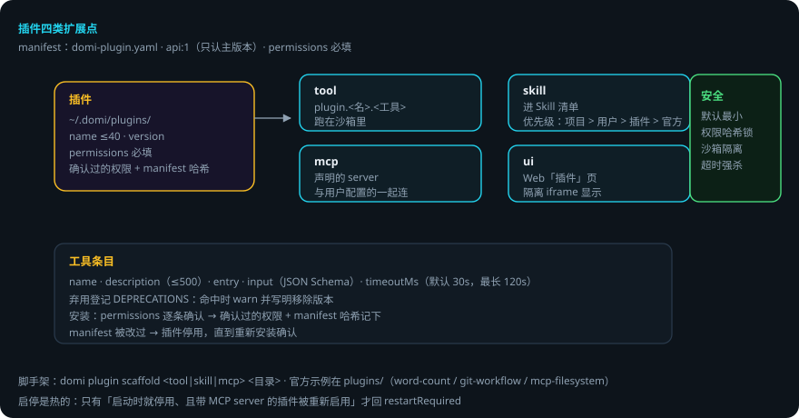
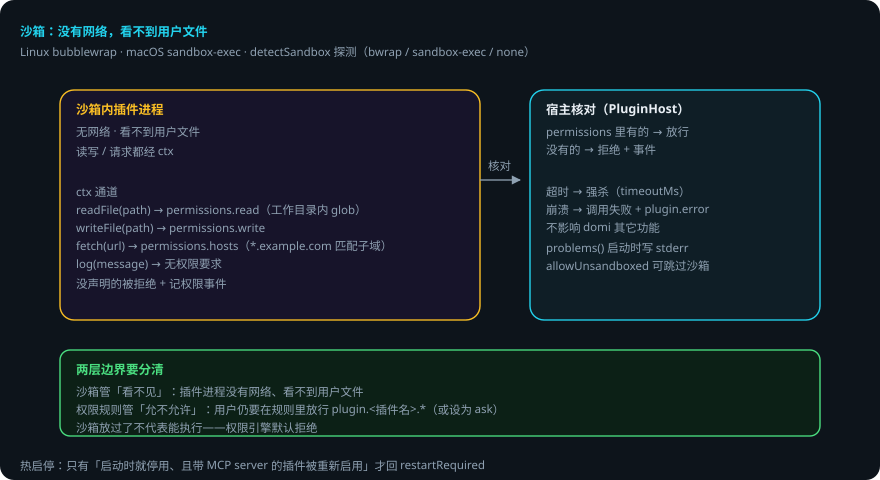

# 插件运行时

> 本页回答四个问题：插件能扩展什么？manifest 怎么保证安全？沙箱管什么、权限规则管什么？出错了会怎样？
> `packages/plugin` —— 插件宿主。**写插件的教程在[插件开发](plugin-dev.md)；本页讲宿主机制**。
> 贯穿例子：给登录接口加限流——你装了一个 git-workflow 插件，domi 用它提交代码。

## 先说结论

- 插件有四类扩展点：**tool / skill / mcp / ui**。
- 插件工具注册为 `plugin.<插件名>.<工具名>`，跑在沙箱里。
- **permissions 必填**；安装时逐条确认，确认过的权限连同 manifest 哈希记下——之后 manifest 被改过，插件就停用，直到重新安装确认。
- 沙箱：带代码的工具**没有网络、看不到任何用户文件**。读写文件、发请求都经 `ctx`，宿主按声明的权限核对。
- 沙箱管的是「看不见」，权限规则管的是「允不允许」——两个独立机制。
- 工具超时被强杀；崩溃不影响 domi，只让这次调用失败并留一条 `plugin.error`。

## 用到的词

| 词 | 意思 |
|---|---|
| 扩展点 | 插件能贡献的东西：工具 / 技能 / MCP server / UI 面板。 |
| manifest | `domi-plugin.yaml`，插件的声明文件。 |
| 沙箱 | 限制进程能力的系统机制（bwrap / sandbox-exec）。 |
| ctx | 宿主给插件的受限通道（读 / 写 / 请求 / 日志）。 |
| 热启停 | 插件启用 / 停用即时生效，不用重启 daemon。 |

## 1. 四类扩展点

| 扩展点 | 宿主怎么用 |
|---|---|
| tool | 注册为 `plugin.<插件名>.<工具名>`，跑在沙箱里 |
| skill | 进 Skill 清单（同名优先级：项目 > 用户 > 插件 > 官方） |
| mcp | 声明的 server 与用户自己配的一起连 |
| ui | Web「插件」页隔离 iframe 里显示 |

## 2. manifest 与安装

`domi-plugin.yaml`（`api: 1`，`PLUGIN_API_VERSION`，只认主版本）。字段：

- `name`：小写字母数字与 `-`，最长 40。
- `version` / `description`。
- **`permissions`（必填）**：插件要什么权限，逐条列给用户确认。
- `contributes`：tools / skills / mcp / ui。

工具条目：`name` / `description`（≤500）/ `entry` / `input`（JSON Schema）/ `timeoutMs`（默认 30 秒，最长 120 秒）。弃用登记：`DEPRECATIONS`（命中时 warn 并写明移除版本）。

安装（`install.ts`）：domi 把 `permissions` 逐条列给用户确认；确认过的权限连同 manifest 的哈希一起记下来。**之后 manifest 被改过，插件就停用**，直到重新安装确认。

脚手架：`domi plugin scaffold <tool|skill|mcp> <目录>`。

## 3. 沙箱：没有网络，看不到用户文件

带代码的工具跑在系统级沙箱里（Linux：bubblewrap；macOS：sandbox-exec）。读写文件、发请求都经 `ctx`，宿主按插件声明的权限核对：

| ctx 能力 | 权限来源 |
|---|---|
| `cwd` / `readFile(path)` | `permissions.read`（相对工作目录的 glob，宿主代读） |
| `writeFile(path, content)` | `permissions.write` |
| `fetch(url, ...)` | `permissions.hosts`（`*.example.com` 匹配子域） |
| `log(message)` | 无 |

没声明的被拒绝并记一条权限事件。`allowUnsandboxed` 配置可跳过沙箱（`detectSandbox` 探测：`bwrap` / `sandbox-exec` / `none`）。工具超时被强杀；崩溃不影响 domi，只让这次调用失败并留一条 `plugin.error`。

**两层边界要分清**：

- 沙箱管「看不见」：插件进程没有网络、看不到用户文件。
- 权限规则管「允不允许」：用户仍然要在权限规则里放行 `plugin.<插件名>.*`（或设为 ask）。

## 4. 宿主接线

- `host.ts`：`PluginHost`——加载 `~/.domi/plugins` 下的插件，提供 `tools(cwd)`（含沙箱包装）、`mcpServers()`、`disabledServers()`、`problems()`（加载问题，daemon 启动时逐条写 stderr）、UI 面板数据（`plugin.ui` RPC）。
- `inprocess.ts`：无沙箱路径的进程内执行。
- 启停是热的：只有「启动时就停用、且带 MCP server 的插件被重新启用」才回 `restartRequired`。

## 5. 出错了怎么办：git-workflow 插件调用失败

1. **工具超时**（默认 30 秒）。强杀；这次调用失败，留 `plugin.error`。domi 其它功能不受影响。
2. **权限没声明**（插件想读 `/etc/passwd`）。ctx 拒绝并记权限事件。模型看到拒绝，改路径。
3. **manifest 被改过**。插件停用，直到重新安装确认。daemon 启动时把加载问题逐条写 stderr（`problems()`）。
4. **插件崩溃**。不影响 domi；这次调用失败，留 `plugin.error`。
5. **权限规则没放行**。沙箱放过了，但 `plugin.git-workflow.*` 无规则 → 权限引擎默认拒绝。

### 一张表看全部情况

| 情况 | domi 做什么 | 你要做什么 |
|---|---|---|
| 工具超时 | 强杀，留 plugin.error | 调 timeoutMs 或换实现 |
| 越权访问 | ctx 拒绝，记权限事件 | 补 permissions 声明 |
| manifest 被改 | 停用，直到重新安装 | 重新安装确认 |
| 插件崩溃 | 调用失败，不影响 domi | 看 plugin.error 排查 |
| 权限规则没放行 | 默认拒绝 | 放行 plugin.&lt;插件名&gt;.* |

## 6. 可靠性靠什么

1. **默认最小权限**：permissions 必填、逐条确认、哈希锁死。
2. **沙箱物理隔离**：没有网络、看不到文件——越权连「看见」都做不到。
3. **ctx 是唯一通道**：读写请求都经宿主核对，不留直通路径。
4. **故障隔离**：超时强杀、崩溃不影响 domi。
5. **热启停**：启停即时生效，不用重启。

## 已知限制

- 沙箱依赖系统能力（bwrap / sandbox-exec）；探测不到时只能选 `allowUnsandboxed` 或不用该插件。
- manifest 哈希校验是整文件级的：改一个字段就要求重新确认。
- ui 面板是隔离 iframe：能力有限，适合展示不适合复杂交互。
- 只有「启动时就停用、且带 MCP server」的插件重启用才要求重启。

## 代码在哪里

| 主题 | 位置 |
|---|---|
| 插件宿主 / 加载 / problems | `packages/plugin/src/host.ts` |
| 沙箱包装 | `packages/plugin/src/sandbox.ts` |
| 进程内执行（无沙箱） | `packages/plugin/src/inprocess.ts` |
| manifest 校验 | `packages/plugin/src/manifest.ts` |
| 安装与哈希 | `packages/plugin/src/install.ts` |
| 脚手架 | `packages/plugin/src/scaffold.ts` |

测试：`packages/plugin/test/`（manifest 校验、权限核对、沙箱包装、哈希失效停用）。

## 相关

- 插件工具与内置工具同走权限路径：[工具与权限运行时](tools-runtime.md)。
- 写插件教程与示例：[插件开发](plugin-dev.md)；官方示例在 `plugins/`。
- 插件声明的 MCP server：[MCP 接入](mcp-internals.md)。
