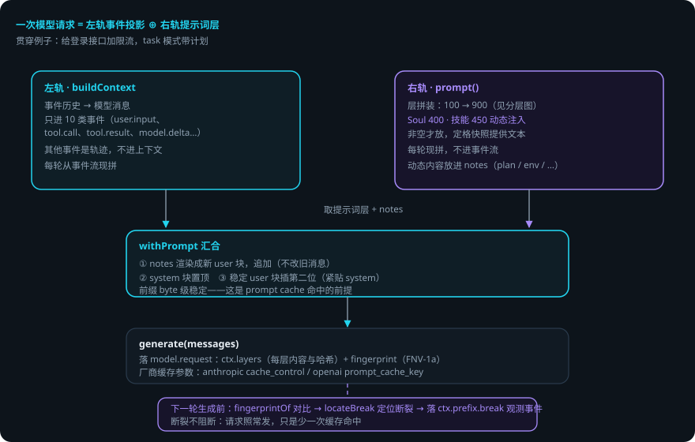
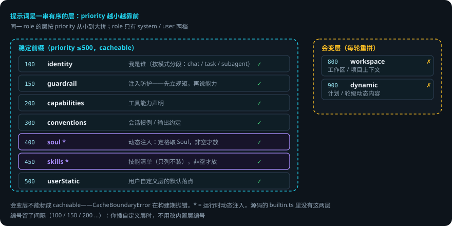

# 提示词分层与 cache 边界

> 本页回答四个问题：模型看到的提示词是怎么拼出来的？Soul 什么时候放进去？为什么前缀必须稳定？前缀断了怎么发现？
> 贯穿例子：给登录接口加限流——domi 以任务模式工作，带计划。

## 先说结论

- 提示词是一串**有序的层**。每层有 id、role、priority、cacheable 四个属性。
- priority ≤500 的层全在**稳定前缀**里。800 / 900 是会变层。
- **Soul 是运行时动态注入的层**（priority 400），非空才放。技能清单同理（450）。
- 动态内容走**追加**（notes），不走改写——前缀保持 byte 级稳定。
- 前缀**指纹**（FNV-1a 哈希）落进每次请求。下一轮对比，断裂可观测。
- 系统提示词每轮现拼，没有本地渲染缓存。prompt cache 命中靠**前缀内容稳定**，不是靠缓存。

## 用到的词

| 词 | 意思 |
|---|---|
| 层 | 提示词的一个有序片段。 |
| 稳定前缀 | 请求开头的固定部分。厂商 prompt cache 按它匹配。 |
| 定格 | turn 开始时一次取齐本轮要用的内容，turn 内不现读。 |
| notes | 运行中的动态内容（计划、环境变化等），追加送达。 |
| 指纹 | 前缀内容的哈希，用来发现缓存断裂。 |
| 会变层 | 每轮内容都可能变的层（计划、动态内容）。 |

## 1. 总体流程

1. 左轨 `buildContext`：把事件历史拼成消息。
2. 右轨 `prompt()`：把各层拼成提示词。Soul 和技能清单在这里动态注入。
3. `withPrompt` 汇合：notes 追加 → system 置顶 → 稳定 user 块插第二位。
4. domi 把整份消息交给模型，同时落 `model.request`（带层清单与指纹）。
5. 下一轮生成前对比指纹，发现前缀断裂就落观测事件。

## 2. 层：提示词是一串有序的片段

一层是一个 `{id, role, priority, cacheable, render}`。role 只有 system / user 两档。同一 role 的层按 priority 从小到大拼。

内置优先级（编号留了间隔，你插层不用改内置编号）：

| priority | 层 | 内容 | cacheable |
|---|---|---|---|
| 100 | builtin.identity | 我是谁（按模式分段） | ✅ |
| 150 | builtin.guardrail | 注入防护——先立规矩，再说能力 | ✅ |
| 200 | capabilities | 工具能力声明 | ✅ |
| 300 | builtin.conventions | 会话惯例 / 输出约定 | ✅ |
| 400 | builtin.soul | **动态注入**（非空才放） | ✅ |
| 450 | builtin.skills | 技能清单（只列不装） | ✅ |
| 500 | userStatic | 用户自定义层的默认落点 | ✅ |
| 800 | workspace | 工作区 / 项目上下文 | ❌ 会变 |
| 900 | dynamic | 计划 / 轮级动态内容 | ❌ 会变 |

**身份按模式分段**（identity 层）：普通会话、任务会话（带计划）、子 agent 的「我是谁」不同。子 agent 有独立上下文，看不到父对话——它的身份必须单独写，不能复用会话身份。

## 3. 稳定前缀：≤500 都别动

prompt cache 按前缀匹配：前缀里任何一个 byte 变了，整个前缀缓存失效。

所以 500 以下（含）都是稳定前缀，800 / 900 是会变层。**会变层不能标成 cacheable**——`CacheBoundaryError` 在构建期就抛错，不是运行期才发现。

## 4. Soul 什么时候放进去

Soul 不在 `packages/prompt/src/builtin.ts` 里——你在源码里找不到它。它在每次 `prompt()` 时注入：

1. turn 开始，domi 定格，从记忆取 Soul 文本。
2. Soul 非空，domi 追加一层：`{id:'builtin.soul', role:'system', priority:400, cacheable:true}`。
3. Soul 为空，不发这一层（免得空占前缀）。
4. 技能清单同理：非空才注入 450 层。

**为什么放稳定前缀**：Soul 极少变。放 400 意味着它参与前缀匹配，每次命中缓存；放会变区则每次都击穿缓存。

**什么时候更新**：Soul 变化不影响当前请求（定格快照不变）。下一轮或显式刷新（`ctx.refresh`）才生效。

## 5. 动态内容走 notes，不走改写

计划提示变化、环境变化这类轮级内容，domi **不**改写已发出的消息（一改，前缀就断了）。它把内容放进 notes，追加送达：

1. `prompt()` 把动态内容放进 `PromptParts.notes`（reason 标记：计划 / 环境 / 验证 / 补充 / 换模型）。
2. `withPrompt` 把 notes 渲染成**新的 user 块**，追加到消息末尾。
3. 主循环落一条 `ctx.note` 事件，让后续轮次也可见（追加送达，允许重复）。

旧的 `PromptParts.dynamic` 字段已弃用——不再拼进最后一条 user 消息。

## 6. 前缀指纹：断了能看见

- 每次请求前，domi 给工具 schema 和每条消息各算一个 FNV-1a 哈希（只记哈希，不记内容），落进 `model.request.fingerprint`。
- 下一轮生成前，`fingerprintOf` 对比上一轮指纹，`locateBreak` 定位断裂点。
- 前缀变化分两种：**预期**（新事件追加——消息变长但前缀一致）；**非预期断裂**（缓存被击穿），落 `ctx.prefix.break` 观测事件。
- 层清单与哈希（`layers` / `layerHashes`）同时落进 `model.request.ctx.layers`，右侧栏上下文 tab 按层展示。

这是「prompt cache 到底有没有被击穿」的运行时证据。

**厂商缓存参数**：请求发出时，domi 按厂商渲染缓存参数（anthropic 的 `cache_control` TTL、openai 兼容网关的 `prompt_cache_key`）。缺省按会话档位：任务会话 3600 秒，自由会话 300 秒（`context.cacheTtlOverride` 可覆盖）。

## 7. 出错了怎么办：第 2 步进行中，你改了配置

还是「给登录接口加限流」。第 2 步写限流中间件进行中，模型正在改 `app.ts`。

1. **你改了 `config.yaml`（环境变化）**。当前请求不受影响——定格快照没变。下一轮生效。你想立即生效就手动 `ctx.refresh`。
2. **计划更新了**（第 2 步标记完成）。domi 把它放进 notes，追加送达，落 `ctx.note`。前缀没动。
3. **厂商缓存断了**（前缀非预期变化）。domi 对比指纹发现断裂，落 `ctx.prefix.break`。请求照常发——只是这次少一次缓存命中，多付一点输入 token。
4. **有人把会变层标成 cacheable**。构建期抛 `CacheBoundaryError`，请求发不出去。修配置（去掉 cacheable 或降 priority）就能恢复。

### 一张表看全部情况

| 情况 | domi 做什么 | 你要做什么 |
|---|---|---|
| 你改了配置 / Soul | 定格快照不变，下一轮生效 | 想立即生效：`ctx.refresh` |
| 计划更新 / 环境变化 | notes 追加送达，落 ctx.note | 不用管 |
| 前缀非预期断裂 | 落 ctx.prefix.break，照常继续 | 通常不用管（只损失缓存命中） |
| 会变层标成 cacheable | CacheBoundaryError 构建期抛错 | 修配置 |
| 模型看不到你的新改动 | 定格快照没刷新 | `ctx.refresh` |

## 8. 可靠性靠什么

1. **层是纯数据。** 同样的层拼出同样的文本。指纹可复算，断裂可观测。
2. **前缀稳定靠纪律。** 追加不改写 + 构建期边界检查，双保险。
3. **边界错误早抛。** 会变层标 cacheable 在构建期就报错，不拖到运行期才发现缓存全断。
4. **指纹只记哈希，不记内容。** 观测缓存健康不泄露会话内容。
5. **定格让一轮内看到的世界一致。** 模型几十步内读到的 Soul、计划、环境是同一份。

## 已知限制

- 系统提示词每轮现拼，**没有本地渲染缓存**。前缀稳定靠内容不变，不是靠缓存层。
- 稳定前缀有代价：前缀越长，每次请求的输入 token 越多。Soul 空时自动省掉这一层。
- 前缀断裂只观测、不自动修复。再次命中缓存要靠后续轮次前缀恢复一致。
- `userStatic`（500）仍在稳定前缀里。用户往这里加长内容会占前缀预算。

## 代码在哪里

| 主题 | 位置 |
|---|---|
| 层结构、内置层与优先级 | `packages/prompt/src/{layer,builtin}.ts` |
| Soul / 技能动态注入（400 / 450） | `packages/runtime/src/session.ts`（`prompt()`） |
| 两轨汇合 withPrompt | `packages/kernel/src/preamble.ts` |
| 前缀指纹与断裂定位 | `packages/kernel/src/fingerprint.ts` |
| 厂商缓存参数渲染 | `packages/runtime/src/session.ts` |
| 定格与 notes 来源 | `packages/runtime/src/session.ts`（`freeze` / `pendingContextChanges`） |
| 配置（cacheTtlOverride 等） | `packages/config/src/schema.ts`（`context.*`） |

测试：`packages/prompt/test/layer.spec.ts`（分层 / 边界 / 缓存失效）。

## 相关

- 两条轨道如何汇合、安全点在哪：[Agent Loop：一轮里发生了什么](agent-loop.md)。
- 遮蔽 / 压缩替换哪一段、为什么不动前缀：[压缩与 prompt cache](context-compression.md)。
- Soul 从哪来：[记忆分层与 Soul](memory-and-soul.md)。
