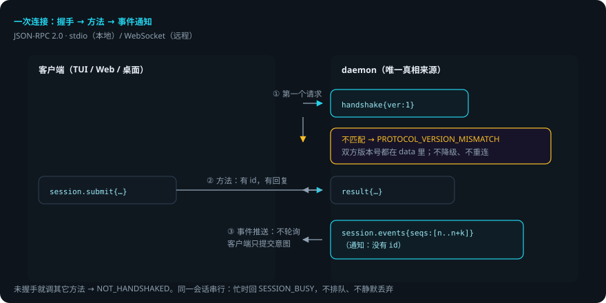
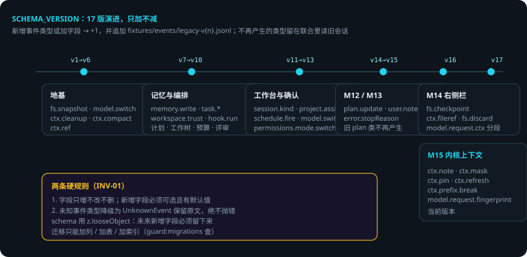
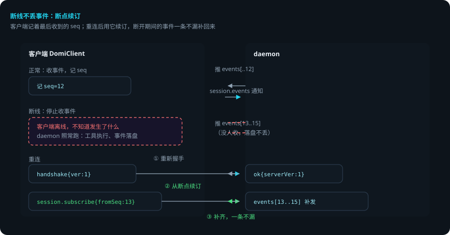

# Domi Protocol：daemon 与客户端之间的契约

> 本页回答四个问题：daemon 和客户端怎么通信？事件流怎么演进而不破坏旧数据？断线了会怎样？改协议要过哪些关？
> 逐字段参考在 [`docs/protocol.md`](../../protocol.md)（由脚本生成，勿手改）。本页讲约定、全景与演进规则。
> 贯穿例子：给登录接口加限流——客户端（TUI / Web / 桌面端）在全程监听这个会话的事件。

## 先说结论

- 传输是 JSON-RPC 2.0：stdio（本地单二进制）或 WebSocket（远程）。
- **握手必须是第一个请求**。版本不匹配直接拒绝，不降级、不重连。
- **daemon 是事件流的唯一写入者**。客户端只提交意图；同一会话串行，忙时回 `SESSION_BUSY`。
- 事件推送是**通知**（没有 id），客户端不轮询。断线靠 `session.subscribe` 的 `fromSeq` 断点续订。
- 事件 schema 只增不改不删（`SCHEMA_VERSION` 17）。未知事件降级为 `UnknownEvent`，历史永远可解析。
- 改协议有 CI 门：`guard:protocol` / `guard:api` / `guard:append-only` / `guard:migrations`。

## 用到的词

| 词 | 意思 |
|---|---|
| 握手 | 连接后的第一个请求，交换版本号。 |
| 通知 | 没有 id 的 JSON-RPC 消息，不期待回复。 |
| 方法 | 客户端调 daemon 的请求（如 `session.submit`）。 |
| 事件 | daemon 产生的流式记录（如 `model.delta`）。 |
| 断点续订 | 重连后从上次的 seq 继续订阅，不丢事件。 |
| 投影 | 从事件流算出来的视图（上下文、轨迹、状态栏）。 |

## 1. 传输与约定

1. 客户端连接，先发 `handshake`。
2. 版本匹配：继续。不匹配：返回 `PROTOCOL_VERSION_MISMATCH`，**双方版本号都在 data 里**。不降级、不重连。
3. 客户端调方法（如 `session.submit`），daemon 处理并回结果。
4. daemon 产生的事件作为通知推给所有订阅了该会话的客户端。

未握手就调其它方法，返回 `NOT_HANDSHAKED`。daemon 的报错带 `messageKey` + `params`，端上按自己的语言渲染（i18n）。

## 2. 方法全景

客户端能调什么，由 `METHODS`（`packages/protocol/src/rpc.ts`）定义。按用途分组：

| 组 | 方法（示例） |
|---|---|
| 会话 | `session.list` `session.create` `session.submit` `session.note` `session.interrupt` `session.subscribe` `session.history` `session.compact` `session.branch` `session.switchModel` `session.budget` |
| 记忆 | `memory.list` `memory.search` `memory.delete` `memory.extract` |
| Soul | `soul.get` `soul.write` `soul.export` `soul.import` `soul.review` |
| 任务 / 评审 | `task.start` `task.list` `task.retry` `task.cancel` `review.start` |
| 插件 / 项目 / 定时 | `plugin.list` `plugin.ui` · `project.list` `project.create` `project.archive` · `schedule.create` `schedule.runs` `schedule.preview` |
| 配置 / 模型 | `config.get` `config.set` `provider.vendors` `model.list` `skill.list` |
| 工作树 | `worktree.diff` `worktree.discard` `worktree.restore` `worktree.apply` |
| 其它 | `usage.summary` `fs.list` `attachment.put` `audit.record` |

## 3. 事件全景

daemon 主动推的事件（`DomiEventSchema`）。订阅后一次一批、seq 连续：

| 组 | 事件 |
|---|---|
| 用户侧 | `user.input`（轮边界） `user.note`（运行中补充） |
| 模型侧 | `model.request` `model.delta` `model.reason` `model.usage` `model.switch` |
| 工具侧 | `tool.call` `tool.result` `fs.snapshot` `fs.checkpoint` `permission` |
| 上下文 | `ctx.cleanup` `ctx.compact` `ctx.ref` `ctx.note` `ctx.mask` `ctx.pin` `ctx.refresh` `ctx.prefix.break` |
| 记忆 / 任务 / 计划 | `memory.write` · `task.spawn` `task.run` `task.end` · `plan.update` |
| 其它 | `snapshot` `revert` `hook.run` `verify.required` `budget.warn` `schedule.fire` `review.findings` `plugin.error` `error` |

**两条硬规则**（`event.ts` 文件头）：
1. 字段只增不改不删；新增字段必须可选且有默认值。
2. 未知事件类型**降级**为 `UnknownEvent` 保留原文，绝不抛错——历史永远可解析。

schema 用 `z.looseObject`：已知类型遇到未来新增字段时字段必须留下来，否则 payload 还在磁盘上、内存里却没了。

## 4. 事件流怎么演进

两套版本号，职责分开：

| 版本号 | 管什么 | 什么时候升 |
|---|---|---|
| `PROTOCOL_VERSION`（=1） | RPC 面 | 加方法 / 通知不用升；不兼容改动才升，且不降级兼容 |
| `SCHEMA_VERSION`（=17） | 事件面 | **新增事件类型或加字段 +1**，并追加一份 `fixtures/events/legacy-v{n}.jsonl` |

事件面几个关键节点：
- **v1→v6 地基**：`fs.snapshot`、`model.switch`、`ctx.compact`、`ctx.ref`。
- **v7→v10 记忆与编排**：`memory.write`、`task.*`、工作树、预算、评审。
- **v11→v13 工作台**：`session.kind`、`schedule.fire`、`permissions.mode.switch`。
- **v14→v15（M12/M13）**：`plan.update`、`user.note`。
- **v16（M14 右侧栏）**：`fs.checkpoint`、`ctx.fileref`、`fs.discard`。
- **v17（M15 内核上下文）**：`ctx.note`、`ctx.mask`、`ctx.pin`、`ctx.refresh`、`ctx.prefix.break`。

不再产生的事件类型**留在联合里**（读旧会话用），不删。迁移只能加列 / 加表 / 加索引（`guard:migrations` 查）。

## 5. 客户端怎么保证不丢事件

三端（TUI / Web / 桌面）共用 `DomiClient`：

1. **握手**：版本不匹配停在 `incompatible`，不重连、不降级——重连只会一遍遍撞同一堵墙。
2. **断线重连 + 断点续订**：每个会话记着最后收到的 seq，重连后用 `fromSeq` 续订，断开期间的事件一条不漏补回来。
3. **去重**：同一个 seq 只进一次 store——投影是追加式的，重复一次就是重复一条消息。

客户端必须能在浏览器里跑：不 import 任何 node 模块，不依赖 DOM 类型，连接用最小的 `WireSocket` 描述（浏览器 WebSocket 与 Bun WebSocket 的公共子集）。

## 6. 出错了怎么办：限流第 2 步做到一半，客户端断线

还是「给登录接口加限流」。第 2 步写限流中间件进行中，你的终端断网了。

1. **断线**。客户端停在最后收到的 seq。daemon 继续跑：工具执行、事件落盘都不受影响。
2. **重连**。客户端重新握手，成功后用 `fromSeq` 续订。断线期间 domi 写过的所有事件（`tool.result`、`model.delta`、`permission`……）一次性补回来。
3. **版本不匹配**（daemon 升级了，客户端是旧的）。握手返回 `PROTOCOL_VERSION_MISMATCH`，客户端停在 `incompatible`。升级客户端即可。
4. **会话忙**（另一个请求正在处理这个会话）。返回 `SESSION_BUSY`。不排队、不静默丢弃——客户端看到明确错误，稍后再试。
5. **未知事件**（daemon 更新了事件类型，旧客户端不认识）。降级为 `UnknownEvent` 保留原文，不抛错。

### 一张表看全部情况

| 情况 | domi 做什么 | 你要做什么 |
|---|---|---|
| 断线 | 记最后 seq，重连后 `fromSeq` 续订补事件 | 不用管 |
| 版本不匹配 | 握手拒绝，客户端停 incompatible | 升级客户端（或回退 daemon） |
| 会话忙 | 回 SESSION_BUSY，不排队 | 稍后再试 |
| 旧客户端遇新事件 | 降级 UnknownEvent，不抛错 | 不用管（升级后能看到完整） |
| 你改协议 | guard:protocol 等四个守卫把关 | 升版本 + 补 fixture + 重新生成文档 |

## 7. 改协议的完整流程

1. 改 `rpc.ts`（方法）或 `event.ts`（事件）。事件变更按版本规则升 `SCHEMA_VERSION` 并补 fixture。
2. `bun run scripts/gen-protocol-docs.ts` 重新生成 `docs/protocol.md` / `docs/protocol.schema.json`；`bun run scripts/gen-api-snapshot.ts` 重新生成 `.api.md`。
3. 跑 `pnpm guard`：`guard:protocol` / `guard:api` / `guard:append-only` / `guard:migrations` 都会查。
4. 在 `docs/tasks/M*.md` 里登记（协议改动须有 PRD 引用）。

## 8. 可靠性靠什么

1. **只增不改**。字段加、类型留、迁移只加列——旧数据永远可读。
2. **未知即降级**。新事件在旧客户端里不炸，历史永远可解析。
3. **断点续订**。断线不丢事件，重连一次补齐。
4. **错误码可见**。`SESSION_BUSY` 比 `-32001` 省一次查表——错误码最终会出现在终端里和 issue 里。
5. **版本门禁**。不兼容改动被守卫挡住，漏改一个 fixture 都红。

## 已知限制

- 不降级兼容：老客户端必须升级才能连新版 daemon。
- 会话串行：同一会话同时只处理一个请求，并发场景要排队。
- `SCHEMA_VERSION` 升了就要补 fixture，改一次事件面至少要动四个文件。
- 客户端投影是追加式的：重复推送会让投影错乱，去重靠 seq 纪律。

## 代码在哪里

| 主题 | 位置 |
|---|---|
| 方法 / 错误码 / 握手 | `packages/protocol/src/rpc.ts` |
| 事件 schema 与版本 | `packages/protocol/src/event.ts` |
| 客户端（握手 / 续订 / 去重） | `packages/client-core/src/client.ts` |
| 生成协议文档 | `scripts/gen-protocol-docs.ts` |
| 历史事件 fixture | `fixtures/events/legacy-v*.jsonl` |

## 相关

- 事件流怎么被消费：[Agent Loop：一轮里发生了什么](agent-loop.md)。
- 断线重连后 UI 怎么投影：[轨迹与回放](trajectory-and-replay.md)。
- 会话怎么存储：[会话存储](session-storage.md)。
