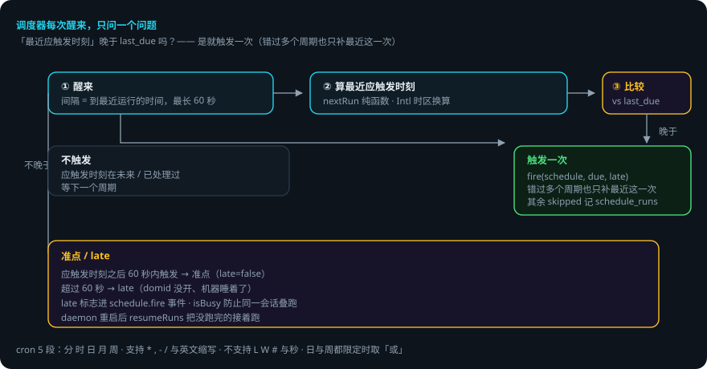
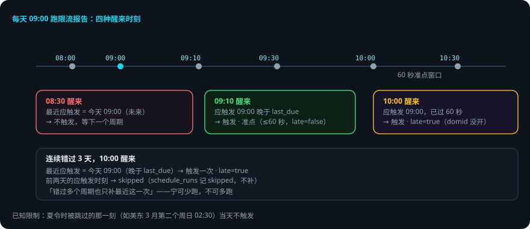

# 定时任务

> 本页回答四个问题：cron 怎么写？调度器怎么醒来、怎么补触发？迟到了会怎样？出错了会怎样？
> 交互演示：[错过补触发模拟](scheduling-explainer.html)（选场景，看调度器怎么判定准点 / late / 只补一次）。
> `packages/daemon/src/{cron,scheduler}.ts`。
> 贯穿例子：每天早上 9 点给登录接口跑一次限流报告。

## 先说结论

- cron 是 **5 段**：分 时 日 月 周。支持 `*` `,` `-` `/` 与英文缩写；**不支持 `L` `W` `#` 与秒**。
- 时区用 `Intl` 换算，不引依赖；`nextRun` / `prevRun` 是纯函数，可单测。
- 调度器在 domid 进程里跑，时钟与定时器**全部注入**（测试用假时钟）。
- **错过只补一次**：醒来时「最近应触发时刻」晚于 `last_due` 就触发一次，错过多个周期也只补最近这一次。
- 醒来的间隔最长 **60 秒**：系统休眠后定时器会漂，靠这个兜底。
- 应触发时刻之后 60 秒内算**准点**，超过算 **late**（domid 没开、机器睡着了）——`late` 标志进 `schedule.fire` 事件。

## 用到的词

| 词 | 意思 |
|---|---|
| 段 | cron 的一个字段（分 / 时 / 日 / 月 / 周）。 |
| last_due | 上次触发过的应触发时刻。 |
| 准点 | 触发发生在应触发时刻后 60 秒内。 |
| late | 触发发生在应触发时刻后超过 60 秒。 |
| 补触发 | domid 醒来时补跑错过的最近一次。 |

## 1. 总体流程

## 2. cron 表达式

5 段：分 时 日 月 周。支持 `*` `,` `-` `/`、月份与星期的英文缩写，周日写 0 或 7。**不支持 `L` `W` `#` 与秒**；日与周都限定时按 Vixie cron 的规矩取「或」。

时区换算（`Intl`，不引依赖）：在 UTC 分钟上走，每一步看它在目标时区里是几月几日几点，按不匹配的那一级往前跳。

已知限制：**夏令时被跳过的那一刻**（例如美东 3 月第二个周日 02:30）当天不触发。

## 3. 调度器：错过只补一次

`scheduler.ts` 在 domid 进程里跑：

1. 每次醒来，对每个计划算「不晚于现在的最近一个应触发时刻」。
2. 它晚于 `last_due`？是 → 触发一次（**错过多个周期也只补这一次**）。否 → 不触发。
3. 醒来的间隔 = 到最近一次运行的时间，**最长 60 秒**（系统休眠之后定时器会漂，靠这个兜底）。
4. 应触发时刻之后 60 秒内算准点，超过就是 `late` —— `fire(schedule, due, late)` 的 `late` 标志进 `schedule.fire` 事件。

## 4. 触发 → 任务

`fire` 真的去建任务并提交目标，返回会话 id（`task.start` 的 runId 就是会话 id）；`isBusy` 防止同一会话叠跑。调度器用的内部连接（`SYSTEM_CONN`）：不订阅、不收推送。daemon 重启后 `resumeRuns` 把没跑完的接着跑。

RPC 面：`schedule.list / create / update / delete / runs / preview`（`previewCron` 给下一次触发时间）；`schedule.fire` 是事件。

## 5. 出错了怎么办：机器睡了 3 个小时，9 点的报告没跑

还是「每天早上 9 点跑限流报告」。今天你 10 点才打开电脑（domid 在 9 点没开）。

1. **domid 醒来（10:00）**。调度器对「每天 9 点」这个计划算最近应触发时刻 = 今天 09:00。
2. **与 last_due 比较**。昨天 09:00 已触发（last_due = 昨天 09:00）→ 今天 09:00 晚于 last_due → **触发一次**。
3. **准点 / late 判定**。触发时刻 10:00 距应触发 09:00 超过 60 秒 → `late: true`，进 `schedule.fire` 事件。
4. **假如连续错过 3 天**。醒来时最近应触发 = 今天 09:00（晚于 last_due）→ 只补今天这一次，前两天的跳过（`schedule_runs` 里记 skipped）。
5. **假如你在 08:30 打开**。最近应触发 = 今天 09:00，是未来时刻 → 不触发，等 09:00 正常跑。

### 一张表看全部情况

| 情况 | 调度器做什么 | 你要做什么 |
|---|---|---|
| 没到应触发时刻 | 不算触发 | 不用管 |
| 醒来时刚错过（≤60 秒） | 触发，late=false（准点） | 不用管 |
| 醒来时错过很久（>60 秒） | 触发一次，late=true | 不用管（看 schedule.fire 的 late） |
| 连续错过多个周期 | 只补最近一次，其余 skipped | 不用管 |
| 夏令时被跳过的那刻 | 当天不触发 | 已知限制 |
| 同一会话叠跑风险 | isBusy 防止叠跑 | 不用管 |

## 6. 可靠性靠什么

1. **纯函数核心**。`nextRun` / `prevRun` 可单测，时区逻辑不依赖环境。
2. **时钟注入**。测试用假时钟，时间行为确定性。
3. **兜底唤醒**。最长 60 秒间隔，休眠后不永久漂移。
4. **错过有交代**。只补一次 + skipped 记录 + late 标志，行为可审计。
5. **防叠跑**。isBusy 保证同一会话不叠跑。

## 已知限制

- cron 不支持 `L` `W` `#` 与秒。
- 夏令时被跳过的那一刻当天不触发。
- 错过多个周期只补一次（设计如此，宁可少跑不可多跑）。
- 调度器在 domid 进程里：domid 没开就没有触发（醒来后按 late 补）。

## 代码在哪里

| 主题 | 位置 |
|---|---|
| cron 解析 / nextRun / prevRun | `packages/daemon/src/cron.ts` |
| 调度器（醒来 / 补触发 / late） | `packages/daemon/src/scheduler.ts` |
| 定时任务存储 | `packages/store/src/schedules.ts` |
| RPC 面 | `packages/daemon/src/core.ts`（schedule.*） |

测试：`packages/daemon/test/scheduler.spec.ts`（假时钟 + 假定时器，含夏令时跳变、错过补触发、late 判定）。

## 相关

- 任务的执行循环：[编排：任务 · 子 agent · 计划](orchestration.md)。
- 调度器住在 daemon 里：[daemon 内部机制](daemon-internals.md)。
