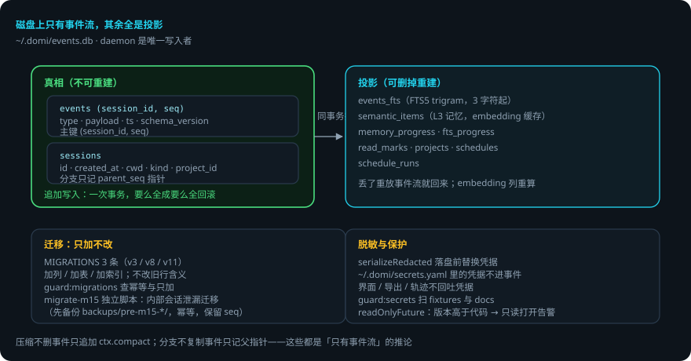
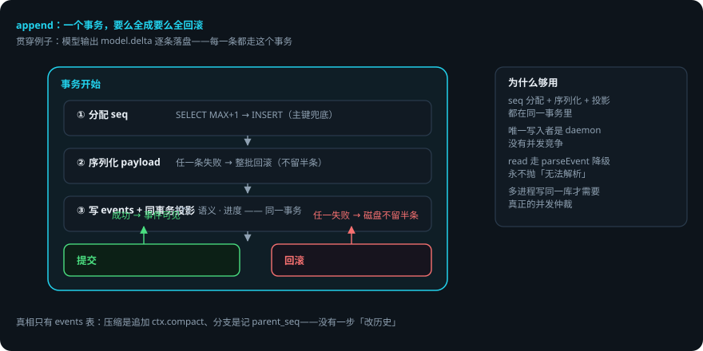

# 会话存储与事件流

> 本页回答四个问题：事件存在哪？一次写入怎么保证原子？哪些表能删掉重建？迁移怎么做到只加不改？
> `packages/store` —— SQLite 事件流（`bun:sqlite`），daemon 是唯一写入者。
> 贯穿例子：给登录接口加限流——你 30 秒前发的那条消息、domi 改过的每个文件版本，都在这条流里。

## 先说结论

- 磁盘上只有**事件流**，其余全是投影。真相是 `events` 表。
- 写入是**一个事务**：seq 分配、序列化、投影表更新要么全成，要么全回滚。
- 投影表（FTS、语义、进度、已读、项目、日程）可以删掉重建，丢了不伤真相。
- 迁移**只加不改**：加列 / 加表 / 加索引。旧行的含义永远不变。
- 磁盘版本高于代码版本时，**只读打开并告警，不拒绝启动**。
- 事件落盘前按 `~/.domi/secrets.yaml` 脱敏，界面 / 导出 / 轨迹都不回吐凭据。

## 用到的词

| 词 | 意思 |
|---|---|
| 事件流 | 只追加的事件序列。会话的全部真相。 |
| 投影 | 从事件流算出来的表或视图（搜索、语义记忆、进度）。 |
| 事务 | 一批操作要么全成、要么全不成的边界。 |
| 迁移 | 旧库升到新 schema 的脚本。 |
| 脱敏 | 落盘前把凭据替换掉。 |

## 1. 总体流程





## 2. 文件与打开

- 生产路径：`~/.domi/events.db`。`:memory:` 仅供不需要跨进程持久化的用例。
- 首次运行，父目录由 store 自己建——「第一次跑就崩」是最劝退的失败方式（SQLite 只会给一句 `SQLITE_CANTOPEN`）。
- PRAGMAS 与 DDL 无条件跑（`IF NOT EXISTS` 幂等）。
- 磁盘版本高于代码版本：置位 `readOnlyFuture`，**只读打开并告警，不拒绝启动**（INV-01 的兑现）。

## 3. 事件表与 seq

```sql
CREATE TABLE events (
  session_id TEXT, seq INTEGER, parent_seq INTEGER, ts INTEGER,
  schema_version INTEGER, type TEXT, payload TEXT
)  -- 主键 (session_id, seq)
```

三个不显然的地方（`sqlite-event-log.ts` 文件头，改之前先读）：

1. **seq 在同一事务内分配**（`SELECT MAX+1 → INSERT`），靠主键兜底。够用是因为只有一个写入者；哪天多进程同时写同一个库才需要换成真正的并发仲裁。
2. **序列化放在事务内部**——一批事件里任意一条序列化失败，整批回滚，磁盘上不会留半条。
3. **read 走 `parseEvent` 的降级路径**，永不抛「无法解析」（INV-01）。

会话元数据在 `sessions` 表（`id` / `created_at` / `cwd`，STRICT 表）。分支记 `parent_seq` 指针，**不复制事件**。

## 4. 投影表：可以删掉重建

真相只有 `events` 表。以下全部在 `append` 的**同一个事务里**投影：

| 表 / 索引 | 是什么 | 丢了怎么办 |
|---|---|---|
| `events_fts`（FTS5） | 全文检索 | 重放重建 |
| `semantic_items` | L3 语义记忆 | 重放重建 |
| `memory_progress` / `fts_progress` | 各投影到第几条 | 重建 |
| `read_marks` | 已读标记 | 重建 |
| `projects` | 项目 | 重建 |
| `schedules` / `schedule_runs` | 定时任务 | 重建 |

两个实现细节：

- **FTS 用 trigram 分词器**。默认的 unicode61 不切中文，「数据库迁移」整条会被当成一个词。代价：查询串至少要三个字符，两个字的中文词匹配不到——那条路径由调用方降级成 LIKE 扫描。
- **embedding 是唯一不来自事件的列**。`semantic_items` 里的向量是算出来的缓存，丢了重算。

## 5. 迁移：只加不改

`migrate.ts` + `schema.ts` 的 `MIGRATIONS`（现有 **3 条**：v3、v8、v11——会话列、子 agent、项目/日程）。规则：

- 迁移只能加列 / 加表 / 加索引，不能改旧行的含义。
- `guard:migrations` 检查迁移是否幂等、是否只做加法。
- `domi migrate` 命令封装（`cli` 的 `migrateDatabase`）。

**M15 有一条独立迁移**（`domi migrate-m15`，`packages/store/src/migrate-m15.ts`）：M4 之前的版本允许 `_` 前缀会话（内部会话）被当作普通会话使用，用户事件可能落进 `_memory`。这个脚本把这些泄漏的用户事件迁出成普通会话，内部会话只留记忆事件。三个硬性要求：

1. 迁移前自动把 `events.db` 复制到 `backups/pre-m15-migration-<ts>/`，失败可回滚。
2. 幂等可重跑：`migrated-<原id>` 会话已存在就跳过。
3. 保留原 seq 映射：`UPDATE session_id` 后原 seq 原样保留，`ctx.ref` 引用照常解析。

它不删任何事件——只是把一批事件从旧会话划到新会话名下（INV-01）。

## 6. 隐私与脱敏

`redact.ts`：`serializeRedacted`——事件落盘前按 `~/.domi/secrets.yaml` 里的凭据做脱敏。界面 / 导出 / 轨迹任何接口都不回吐凭据（HANDOFF 硬规矩 2：凭据不进仓库、不回吐给界面）。`guard:secrets` 扫 `fixtures` 与 `docs`。

## 7. 搜索

`store/search.ts`：`INDEXED_TYPES` 决定哪些事件类型进 FTS（`user.note` 也在列）。查询串 < 3 字符走 LIKE 降级。

## 8. 出错了怎么办：限流第 2 步写到一半，进程崩溃

1. **一批事件写一半崩了**。事务回滚，磁盘上不留半条。重启后从最后一条完整事件继续。
2. **磁盘版本高于代码版本**（你用旧版 domi 打开了新版建的库）。只读打开并告警——绝不写，绝不错乱。升级 domi 即可。
3. **迁移失败**。`migrate-m15` 会把 `events.db` 先备份到 `backups/pre-m15-migration-<ts>/`；失败可回滚。普通迁移是纯加列，失败也不伤旧行。
4. **投影表坏了 / 被删了**。重放事件流重建，真相还在。
5. **凭据泄漏风险**。`serializeRedacted` 在落盘前处理；`guard:secrets` 在 CI 扫 fixtures 与 docs。

### 一张表看全部情况

| 情况 | domi 做什么 | 你要做什么 |
|---|---|---|
| 写入中断 | 事务回滚，不留半条 | 不用管 |
| 库版本比代码新 | 只读打开并告警 | 升级 domi |
| 迁移失败 | m15 先备份可回滚；加列迁移不伤旧行 | 看告警，必要时手动回滚 |
| 投影表坏 | 重放重建 | 不用管 |
| 换了凭据 | 旧库里的脱敏数据不受影响 | 更新 secrets.yaml |

## 9. 为什么只有事件流

- **压缩**：`ctx.compact` 只是又一条事件（INV-12，「压缩后可重放等价」免费得到）。
- **分支 / 回放**：从某 seq 重放即 fork / time-travel。
- **状态栏 / 轨迹 / 记忆**：全是投影，不用另做埋点（INV-13）。
- **整库可审计**：权限决策、模型调用、工具执行都在事件里。

## 已知限制

- 单写入者假设：seq 分配靠主键兜底，多进程写同一库需要换成真正的并发仲裁。
- 单文件单点：没有多副本 / 集群。
- FTS trigram 最少三个字符，两字中文词匹配不到（有 LIKE 降级）。
- `semantic_items` 的 embedding 不是事件来源，重放重建要重新调用 embedding 服务。

## 代码在哪里

| 主题 | 位置 |
|---|---|
| 事件写入（事务 / seq / 投影） | `packages/store/src/sqlite-event-log.ts` |
| 迁移与 schema | `packages/store/src/{migrate,schema}.ts` |
| M15 内部会话泄漏迁移 | `packages/store/src/migrate-m15.ts` |
| 全文检索 / 语义投影 | `packages/store/src/{search,semantic}.ts` |
| 脱敏 | `packages/store/src/redact.ts` |
| 项目 / 日程 / 已读 | `packages/store/src/{projects,schedules,read-marks}.ts` |

测试：`packages/store/test/`（append 原子性、迁移、搜索、脱敏）。

## 相关

- 事件契约与版本规则：[Domi Protocol：daemon 与客户端之间的契约](protocol.md)。
- 记忆与 Soul 的投影关系：[记忆分层与 Soul](memory-and-soul.md)。
- 压缩怎么只追加不删事件：[压缩与 prompt cache](context-compression.md)。
