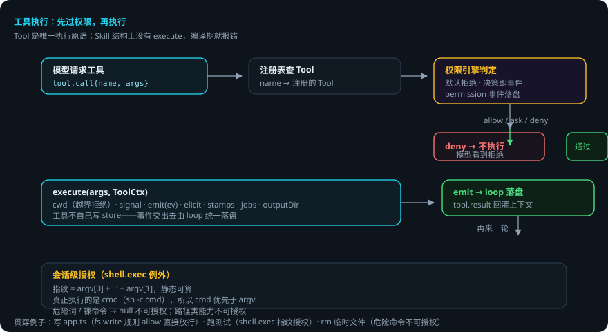
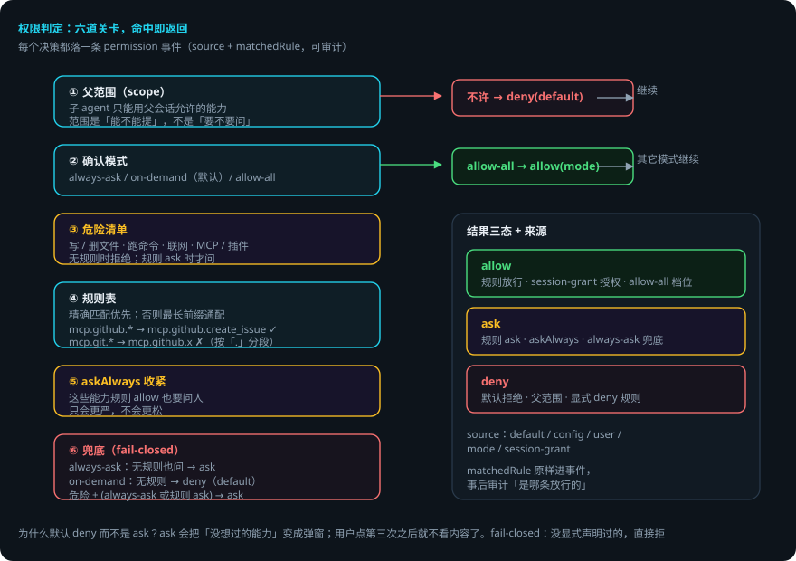

# 工具与权限运行时

> 本页回答四个问题：工具怎么定义、怎么执行？权限是怎么判的？什么默认拒绝、什么可以授权？出错了会怎样？
> 交互演示：[权限判定模拟](tools-runtime-explainer.html)（选能力与配置，看决策链每一步）。
> `packages/capability` —— Tool 注册表、权限引擎、内置工具、Skill 注册表。
> 贯穿例子：给登录接口加限流——domi 要写 `app.ts`（fs.write）、跑测试（shell.exec）、改依赖（fs.edit）。

## 先说结论

- **Tool 是唯一执行原语，Skill 不可执行**。Skill 结构上没有 `execute`，加一个就编译期报错。
- 权限**默认拒绝**，不是默认询问。没显式声明过的能力，直接拒。
- **每个权限决策都产生一条 `permission` 事件**——可审计，轨迹里看得见。
- 判定有五道：父范围 → 确认模式 → 危险清单 → 规则表 → askAlways 收紧，最后才到兜底。
- 通配规则按「.」分段：`mcp.git.*` 管不到 `mcp.github.x`。
- `shell.exec` 是唯一可做会话级授权的工具：按命令指纹（`argv[0] + ' ' + argv[1]`）授权，危险词 / 裸命令不能授权。

## 用到的词

| 词 | 意思 |
|---|---|
| Tool | 可执行原语：名字 + 能力 + schema + execute。 |
| capability | 能力的类别 id（如 `fs.write`）。权限按它判定。 |
| 决策 | allow / deny / ask，带来源与命中的规则。 |
| 会话级授权 | 本会话内持续有效的授权（带 grant）。 |
| 危险能力 | 写 / 删文件、跑命令、联网、MCP 与插件工具。 |
| 指纹 | 命令的可静态计算的摘要，用于授权。 |

## 1. 总体流程





## 2. Tool：类型层强制 INV-05

```ts
interface Tool<A = unknown, R = unknown> {
  readonly name: string
  readonly capability: CapabilityId   // 无此字段无法通过 registerTool 的类型检查
  readonly description: string
  readonly schema: z.ZodType<A>
  readonly inputJsonSchema?: Record<string, unknown>  // MCP 工具 schema 原样给
  execute(args: A, ctx: ToolCtx): Promise<R>
}
```

`ToolCtx` 是工具与外界打交道的全部通道：

| 字段 | 作用 |
|---|---|
| `cwd` | 所有文件访问的根，越界一律拒绝 |
| `signal` | 取消信号 |
| `emit(ev)` | 工具往事件流补事件的通道——工具不自己写 store，事件交出去由 loop 统一落盘 |
| `elicit?` | 向用户要输入 |
| `stamps?` | 过期写保护指纹 |
| `jobs?` | 后台命令 |
| `outputDir?` | 超长输出落盘 |

**Skill 结构上没有 `execute`**（写成 `execute?: never`）：给 Skill 加 execute 在编译期就报错。真正的强制在 kernel：只有 Tool 会被 loop 调用。

## 3. 权限引擎：默认拒绝，决策即事件

判定链（从上到下，命中即返回）：


1. **父范围**（scope）：子 agent 只能用父会话允许的能力。范围是「能不能提」——返回 false 直接拒绝，不看规则、不问人。
2. **确认模式**（permissionsMode）：`always-ask` / `on-demand`（默认）/ `allow-all`。
   - `allow-all`：跳过所有确认（只剩显式 deny 与父范围）。
   - 其它模式继续往下。
3. **危险清单**：危险能力（写 / 删 / 移动文件、跑命令、联网、MCP 与插件工具）——无规则时拒绝，规则 ask 时才问。
4. **规则表**（rules）：精确匹配优先；没有精确匹配取前缀最长的 `前缀.*` 通配。`mcp.github.*` 管得到 `mcp.github.create_issue`，管不到 `mcp.githubx.y`（按「.」分段）。
5. **askAlways 收紧**：这些能力即使规则说 allow 也要问人；只会更严，不会更松。
6. **兜底**：`always-ask` 无规则也问；`on-demand` 无规则拒（默认分支返回 deny，不是 ask）。

为什么默认 deny 而不是 ask？ask 看起来更友好，实际上是把「没想过的能力」变成「弹个窗让用户点同意」，用户点第三次之后就不看内容了。fail-closed 的意思是：没显式声明过的，直接拒。

`Decision`：`allow | deny | ask`，带 `source`（`default` / `config` / `user` / `mode` / `session-grant`）、`matchedRule`、`channel`（用户在哪个端回答的）、`grant`（会话级授权）。**每个决策都产生一条 `permission` 事件**。

## 4. 会话级授权：shell.exec 为什么特殊

`grantFor`：`shell.exec` 例外地可授权——命令指纹 `argv[0] + ' ' + argv[1]` 可静态算。危险词 / 裸命令返回 null 不可授权。

真正被执行的是 `cmd`（`sh -c cmd`），所以 **`cmd` 优先于 `argv`**——否则带个无害 argv 就能让指纹和实际执行的命令对不上。路径类能力不提供「本会话始终允许」（参数能碰到什么没法静态限定）。

## 5. 内置工具

| 工具 | 说明 |
|---|---|
| `fs.read` / `fs.write` / `fs.edit` / `fs.glob` / `fs.grep` / `fs.list` | 文件操作；`fs.write` 带 `fs.snapshot` 前后指纹（过期写保护 `stamps.ts`） |
| `shell.exec` / `shell-jobs` | 命令执行（`sh -c`）与后台任务；指纹授权 |
| `skill.load` | 模型主动加载 Skill 正文（渐进式披露） |
| `task.spawn` | 子 agent（见[编排](orchestration.md)） |
| `ask.user` / `plan.update` | 提问与计划（runtime 注入） |
| `memory.recall` / `review.report` | 记忆检索与评审（runtime 注入） |

代码智能工具（`packages/codeintel`）：`makeOutlineTool`（文件结构大纲）、`makeDiagnosticsTool`（TS 诊断）。这些是工具不是内核能力——模型用它们「看」代码，然后自己决定怎么改。

## 6. 出错了怎么办：限流做到第 2 步，domi 想删临时文件

1. **写 `app.ts`**。规则里有 `fs.write: allow` → 决策 allow，落 `permission` 事件。执行 `fs.write`，前后指纹落 `fs.snapshot`。
2. **跑测试**。`shell.exec` 命中规则 ask（或无规则，on-demand 默认）→ 决策 ask，弹窗问你。你点「允许并记住本会话」→ 会话级授权，本轮后续命令不再问。
3. **domi 想 `rm` 临时文件**。`rm` 是危险命令，指纹算不出 → 不可授权；规则没有 → 决策 deny。domi 看到 deny，改走别的路径。
4. **规则写错了**（`mcp.git.*` 想管 `mcp.github.x`）。按「.」分段，`mcp.git.*` 管不到 `mcp.github.x` → 该能力走了兜底。修规则即可。
5. **子 agent 想用父会话没允许的能力**。父范围返回 false → 直接 deny（source: default，PARENT_SCOPE_RULE）。审计能看见。

### 一张表看全部情况

| 情况 | domi 做什么 | 你要做什么 |
|---|---|---|
| 规则 allow | 直接执行，落 permission 事件 | 不用管 |
| 规则 ask / 无规则 always-ask | 弹窗问 | 允许 / 拒绝 / 会话级授权 |
| 无规则 on-demand | 默认拒绝 | 想放行：加规则或切模式 |
| 危险命令（rm 等） | 指纹算不出 → 不可授权 | 手动执行或放宽规则 |
| 子 agent 越权 | 父范围拦截，直接 deny | 在父会话允许该能力 |
| 规则写错（通配） | 按「.」分段，不误匹配 | 修规则 |

## 7. 可靠性靠什么

1. **fail-closed**。默认 deny，没声明过的不存在「碰运气」。
2. **类型层强制**。capability 字段、Skill 无 execute，都是编译期报错。
3. **决策即事件**。每个判定落 `permission` 事件，事后可审计「是哪条放行的」。
4. **指纹静态可算**。授权对象是命令的可验证摘要，不是用户的「信任」。
5. **范围先于规则**。子 agent 越权在规则之前就被拦，不进入问人路径。

## 已知限制

- `shell.exec` 是唯一可会话级授权的工具；路径类能力不能（参数无法静态限定）。
- 通配规则按「.」分段：不匹配 `mcp.githubx.y` 这种「看起来像」的写法（设计如此，宁严勿松）。
- `allow-all` 模式只适合受信环境；它会跳过确认（只剩显式 deny 与父范围）。
- Skill 不可执行是结构保证，但 Skill 内容仍可能诱导模型调用工具——那是提示词层面的事，不是执行层面。

## 代码在哪里

| 主题 | 位置 |
|---|---|
| 权限引擎（判定链） | `packages/capability/src/permission.ts` |
| Tool 接口与注册表 | `packages/capability/src/*` |
| 内置工具 | `packages/capability/src/tools/` |
| 危险能力清单 | `packages/capability/src/tools/dangerous.ts` |
| 过期写保护 | `packages/capability/src/tools/stamps.ts` |
| 代码智能工具 | `packages/codeintel/src/*` |

测试：`packages/capability/test/`（权限默认值断言、规则匹配、指纹、越界拒绝）。

## 相关

- 工具的执行入口（loop）与 ToolCtx 装配：[Agent Loop：一轮里发生了什么](agent-loop.md)。
- 加一个内置工具：[添加工具](adding-tools.md)。
- 插件工具 / MCP 工具如何变成普通 Tool：[插件运行时](plugins.md)、[MCP 接入](mcp-internals.md)。
