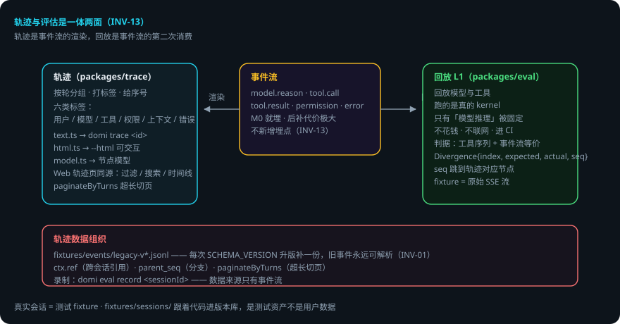

# 轨迹与回放

> 本页回答四个问题：轨迹是什么？回放怎么用真实会话当测试？轨迹数据怎么组织？出错了会怎样？
> `packages/trace` + `packages/eval` 的 L1。
> domi 把它做成了一等公民：**轨迹与评估是一体两面**——轨迹是事件流的渲染，回放是事件流的第二次消费（INV-13）。
> 贯穿例子：给登录接口加限流——改动前先 `domi trace <id> --html` 看历史，改完用同一会话回放验证。

## 先说结论

- **轨迹 = 事件流的渲染，不是另做 tracing**。`model.reason` / `tool.call` / `tool.result` / `permission` / `error` 每条事件都是轨迹的一节。
- 埋点必须第一天就做：`model.reason` 与 `tool.*` 事件从 M0 就埋，后补代价极大。
- **回放 = 真实会话当测试 fixture**：回放的是模型与工具，跑的是真的 kernel；不花钱、不联网、可进 CI。
- fixture 存模型的**原始 SSE 响应流**，不是最终结果——只有「模型推理」被固定住。
- 判据是「工具调用序列 + 事件流等价」，对不上给 `Divergence{index, expected, actual, seq}`——seq 直接跳到轨迹面板对应节点。
- 分页 / 引用 / 分支在事件里都有对应：`ctx.ref` / `parent_seq` / `paginateByTurns`。

## 用到的词

| 词 | 意思 |
|---|---|
| 轨迹 | 事件流按轮分组、打标签、给序号的渲染。 |
| 回放 | 用录制的模型响应重跑真实 kernel。 |
| fixture | 录制的原始 SSE 响应流（测试资产）。 |
| 节点模型 | 轨迹的六类标签（用户 / 模型 / 工具 / 权限 / 上下文 / 错误）。 |

## 1. 总体流程

## 2. 轨迹 = 事件流的渲染

事件流里每一条 `model.reason`（思维链）、`tool.call` / `tool.result`、`permission`、`error` 都是轨迹的一节。渲染层只是把事件按轮分组、打标签、给序号：

- `packages/trace/src/text.ts` —— 纯文本轨迹（`domi trace <id>`）
- `packages/trace/src/html.ts` —— HTML 轨迹（`domi trace <id> --html <路径>`，可交互）
- `packages/trace/src/model.ts` —— 轨迹的节点模型（用户 / 模型 / 工具 / 权限 / 上下文 / 错误六类标签）

Web 端「轨迹」页用同一份模型：按轮分组、六类标签、Turns / Calls 过滤、搜索、时间线。TUI 的 `domi trace` CLI 与 `--html` 输出同源。

**埋点必须第一天就做**：`model.reason` 与 `tool.*` 事件从 M0 就埋，后补代价极大。

## 3. 回放：真实会话 = 测试 fixture

事件流可回放 ⟹ 真实会话可以当作测试 fixture 重放。这就是 L1（`packages/eval/src/replay.ts`）：

- **回放的是模型与工具，跑的是真的 kernel**：真的 `buildContext`、真的 `runTurn`、真的终止条件、真的事件流。所以它能抓到「改了 prompt 之后工具调用顺序变了」这类回归。
- **不花钱、不联网、可进 CI**。回放期间任何出站调用都让测试失败（`assertNoNetwork`）。
- fixture 存**模型的原始 SSE 响应流**，不是最终结果——tool 执行、权限检查、事件生成、压缩触发全都还在真实跑，只有「模型推理」这一步被固定住（`fixtures/sessions/`，跟着代码进版本库，是测试资产不是用户数据）。
- 判据是「工具调用序列 + 事件流等价」：从第几次调用开始对不上，给出 `Divergence{index, expected, actual, seq}`——seq 能直接跳到轨迹面板的对应节点。

录制：`domi eval record <sessionId>`（数据来源只有事件流，不新增埋点）。

## 4. 轨迹数据的组织

- `fixtures/events/legacy-v*.jsonl` —— 历史事件流 fixture：每次 `SCHEMA_VERSION` 升版补一份，保证旧事件永远可解析（INV-01 的机器验证）。
- 分页 / 引用 / 分支在事件里都有对应：`ctx.ref`（跨会话引用）、`parent_seq`（分支）、`paginateByTurns`（超长会话按轮切页）。

## 5. 出错了怎么办：回放对不上，怎么看

1. **工具调用顺序变了**。`Divergence{index, expected, actual, seq}`——从第几次开始对不上。用 `seq` 跳到轨迹面板对应节点，看是哪一步变了。
2. **改了 schema 旧事件解析不了**。`fixtures/events/legacy-v*.jsonl` 保证旧事件永远可解析——升版时补一份。
3. **回放期间出站调用**。`assertNoNetwork` 失败。查 fixture 是否依赖网络。
4. **轨迹缺节**。`model.reason` / `tool.*` 事件没埋全——后补代价极大，这是 M0 就要做的事。
5. **超长会话加载慢**。`paginateByTurns` 按轮切页。

### 一张表看全部情况

| 情况 | domi 做什么 | 你要做什么 |
|---|---|---|
| 回放对不上 | Divergence（index/seq） | 用 seq 跳轨迹节点排查 |
| schema 升版 | legacy fixture 保解析 | 升版补一份 legacy-v* |
| 有出站调用 | assertNoNetwork 失败 | 查 fixture 依赖 |
| 轨迹缺节 | — | 补事件埋点（M0 就该有） |
| 超长会话 | paginateByTurns 切页 | 不用管 |

## 6. 可靠性靠什么

1. **一体两面**：轨迹与评估用同一份事件流，不重复造数据。
2. **埋点先行**：M0 就埋 reason / tool 事件，后补成本可控。
3. **只固定模型推理**：回放时其余环节真实跑，回归抓得到。
4. **旧事件永可解析**：legacy fixture 随 schema 升版补齐。
5. **seq 可跳转**：Divergence 与轨迹面板用 seq 对齐，排查有入口。

## 已知限制

- 回放只固定「模型推理」：其它环节仍受环境影响。
- fixture 是测试资产：行为变更后可能需要重录。
- 轨迹渲染只覆盖事件流已有的事件：没埋的点画不出来。
- legacy fixture 需要人工随升版维护。

## 代码在哪里

| 主题 | 位置 |
|---|---|
| 纯文本轨迹 | `packages/trace/src/text.ts` |
| HTML 轨迹 | `packages/trace/src/html.ts` |
| 节点模型（六类标签） | `packages/trace/src/model.ts` |
| L1 回放 | `packages/eval/src/replay.ts` |
| 历史事件流 fixture | `fixtures/events/legacy-v*.jsonl` |
| 会话 fixture | `fixtures/sessions/` |

## 相关

- 事件契约：[Domi Protocol](protocol.md)。
- L1 / L2 评估体系：[评估体系](eval.md)。
- 状态栏指标（另一个事件流投影）：`packages/observability/src/report.ts` 与 `packages/kernel/src/metrics.ts`。
